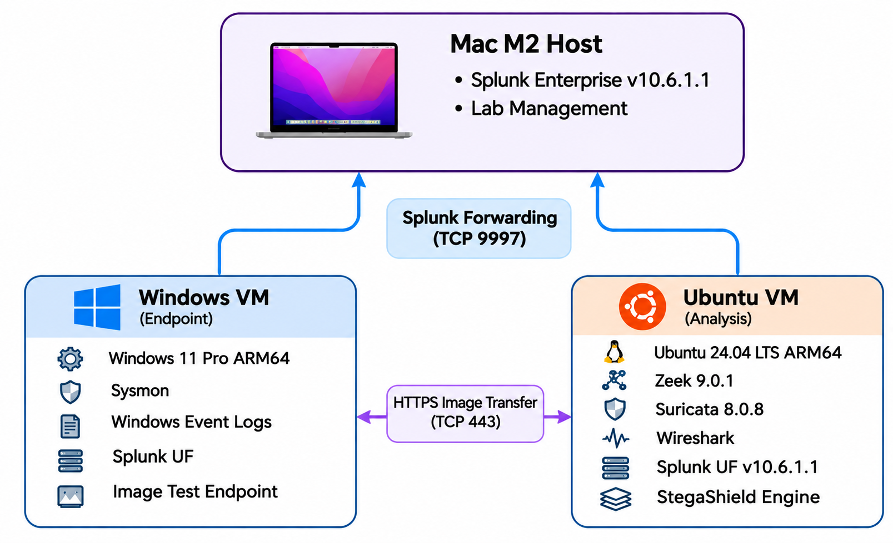

# StegaShield Detection Validation Pilot

**Independent Detection Validation | SOC Investigation | Reproducibility**

An evidence-driven cybersecurity research project evaluating StegaShield's image steganography detection behavior within a controlled SOC laboratory.

This repository documents an independent validation pilot involving controlled image generation, steganography detection testing, SOC telemetry correlation, and evidence integrity verification.

---

## Project Overview

I conducted this independent pilot to investigate how StegaShield classifies known-clean and genuinely steganographically modified images.

The objective was not simply to demonstrate a working detection tool. I wanted to establish independent ground truth, test the detection engine under controlled conditions, investigate unexpected results, and determine whether the associated activity could be reconstructed using SOC telemetry.

The practical investigation consisted of seven hands-on stages.

For GitHub documentation, I organized the completed work into eight phases, with Phase 08 serving as the consolidated technical assessment rather than an additional experiment.

Each phase documents its methodology, observations, findings, limitations, and selected supporting evidence where available.

### Documentation Guide

| Document | Purpose |
|---|---|
| [Master README](README.md) | Project overview, architecture, research objectives, findings, and navigation |
| [Complete Investigation Notes](investigation-notes.md) | Consolidated SOC analyst handoff covering all seven hands-on stages |
| [Phase Documentation](#project-phases) | Individual investigations, technical observations, and supporting evidence |
| [Final Technical Assessment](phase-08-final-assessment/README.md) | Consolidated findings, limitations, and research recommendations |

---

## Laboratory Architecture

The pilot used a Mac M2 host running Splunk Enterprise, together with Windows 11 and Ubuntu ARM64 virtual machines.

The Windows endpoint generated controlled activity and provided Sysmon process and network telemetry.

Ubuntu hosted the StegaShield detection service, Nginx HTTPS reverse proxy, and Zeek network monitoring.



**Architecture note:** This original laboratory design diagram includes both operational components and initially planned integrations. Components shown in the diagram should not automatically be interpreted as successfully integrated or used during the final experiment.

The verified monitoring and testing paths are documented in their respective phases.

### Core Technologies

| Technology | Purpose |
|---|---|
| Windows 11 ARM64 | Controlled endpoint activity and image submissions |
| Ubuntu 24.04 ARM64 | Detection service and network analysis |
| Splunk Enterprise | Centralized Windows security event investigation |
| Sysmon | Windows process and network telemetry |
| Splunk Universal Forwarder | Windows event forwarding |
| Zeek | Network connection metadata |
| Docker | StegaShield container deployment |
| Nginx | HTTPS reverse proxy and application logging |
| Python and Pillow | Independent image generation and modification |
| SHA-256 | Artifact integrity verification |

### Verified Investigation Flow

```text
Windows 11 — WIN-SOC
192.168.64.20
        |
        | HTTPS TCP 443
        v
Ubuntu — Nginx
192.168.64.19
        |
        | Local HTTP reverse proxy
        v
StegaShield Docker API
127.0.0.1:3000
```

Windows Sysmon telemetry was forwarded to Splunk Enterprise on the Mac host.

Zeek recorded network connection metadata on Ubuntu, while Nginx recorded application requests.

These records were correlated analytically. Native ingestion of the specific Zeek and Nginx records into Splunk was not established during the pilot.

---

## Research Objectives

The project focused on seven research questions:

1. Can StegaShield correctly classify a known-clean image?
2. Can it identify an image containing a genuine RGB-LSB modification?
3. How do the reported model probabilities differ between corresponding clean and modified images?
4. Can an embedded payload be independently verified and recovered?
5. Can Sysmon, Splunk, Zeek, and Nginx evidence support investigation of controlled image submissions?
6. Are the test artifacts and recorded findings reproducible?
7. What limitations must be considered before drawing broader conclusions?

The investigation emphasized independent ground truth, controlled experimentation, accurate interpretation, and evidence-backed conclusions.

---

## Project Phases

The completed investigation is documented in eight phases.

Seven phases contain the practical laboratory work. Phase 08 consolidates the technical assessment without introducing another experiment.

| Phase | Investigation | Documentation |
|---|---|---|
| 01 | Environment & Laboratory Baseline | [View Phase 01](phase-01-environment-baseline/README.md) |
| 02 | Independent Dataset & Ground Truth | [View Phase 02](phase-02-independent-dataset/README.md) |
| 03 | StegaShield Deployment & Clean Baseline | [View Phase 03](phase-03-deployment-baseline/README.md) |
| 04 | RGB-LSB Detection Validation | [View Phase 04](phase-04-lsb-detection-validation/README.md) |
| 05 | Error Analysis & Generalization Limits | [View Phase 05](phase-05-error-analysis/README.md) |
| 06 | HTTPS & SOC Telemetry Correlation | [View Phase 06](phase-06-soc-telemetry-correlation/README.md) |
| 07 | Reproducibility & Evidence Integrity | [View Phase 07](phase-07-reproducibility-integrity/README.md) |
| 08 | Consolidated Technical Assessment | [View Phase 08](phase-08-final-assessment/README.md) |

### Phase 01 — Environment & Laboratory Baseline

Established the laboratory infrastructure and verified endpoint and network monitoring.

Investigated missing Sysmon Event ID 3 telemetry and verified network event collection in Splunk following remediation.

**Documentation:** Text-only technical investigation.

[Read Phase 01](phase-01-environment-baseline/README.md)

### Phase 02 — Independent Dataset & Ground Truth

Created an independently generated image dataset using Python and Pillow.

Established clean and RGB-LSB-modified samples with known labels, a controlled payload, and SHA-256 fingerprints.

[Read Phase 02](phase-02-independent-dataset/README.md)

### Phase 03 — StegaShield Deployment & Clean Baseline

Deployed StegaShield on Ubuntu ARM64 using Docker.

Verified detection service readiness and established a baseline classification using a known-clean image.

[Read Phase 03](phase-03-deployment-baseline/README.md)

### Phase 04 — RGB-LSB Detection Validation

Evaluated StegaShield against an image containing a controlled 23-byte RGB-LSB embedded payload.

Recorded the detector's response and compared the prediction against independently established ground truth.

[Read Phase 04](phase-04-lsb-detection-validation/README.md)

### Phase 05 — Error Analysis & Generalization Limits

Investigated the observed false-negative classification.

Compared reported model probabilities, reviewed repeated analysis records, and documented the limits of interpretation.

[Read Phase 05](phase-05-error-analysis/README.md)

### Phase 06 — HTTPS & SOC Telemetry Correlation

Performed authorized HTTPS image submissions from Windows to Ubuntu.

Investigated process, network, and application activity using Sysmon, Splunk, Zeek, and Nginx.

Correlated an incomplete Sysmon network event with process creation evidence to support executable attribution.

[Read Phase 06](phase-06-soc-telemetry-correlation/README.md)

### Phase 07 — Reproducibility & Evidence Integrity

Reviewed image-generation and reproduction scripts.

Verified image and analysis artifact SHA-256 checksums, inspected the deployed Docker image, recovered the embedded payload, and confirmed temporary artifact cleanup.

[Read Phase 07](phase-07-reproducibility-integrity/README.md)

### Phase 08 — Consolidated Technical Assessment

Consolidated the investigation findings, evidence references, detection results, SOC observations, research limitations, and technical recommendations.

**Phase 08 is a documentation and assessment phase, not an additional experiment.**

[Read Final Assessment](phase-08-final-assessment/README.md)

---

## Complete SOC Investigation Notes

A dedicated technical handoff consolidates the full investigation into one document for SOC analysts, detection engineers, and security researchers.

The investigation notes preserve:

- Objectives and technical scope.
- Laboratory environment and verified architecture.
- Seven-stage investigation chronology.
- Configuration issues and troubleshooting.
- Controlled test methodology and independent ground truth.
- Recorded StegaShield analysis responses.
- SPL queries used during endpoint investigation.
- Sysmon, Zeek, and Nginx correlation reasoning.
- Confirmed findings and dispositions.
- SHA-256 verification and payload recovery.
- Research limitations and technical recommendations.

**[Read the Complete SOC Investigation Notes](investigation-notes.md)**

The consolidated notes provide the cross-phase analyst handoff, while individual phase READMEs preserve focused investigation details and selected supporting evidence.

---

## Key Research Findings

### Detection Validation Results

The controlled sample pair produced the following outcomes:

| Sample | Ground Truth | Prediction | Result |
|---|---|---|---|
| Clean reference image | CLEAN | clean | True Negative |
| RGB-LSB modified image | MODIFIED | clean | False Negative |

StegaShield correctly classified the clean reference image but failed to identify the corresponding image containing a controlled 23-byte RGB-LSB payload.

The modified image received a `clean` prediction despite independently established ground truth and subsequent successful payload recovery.

### Reported Model Probabilities

| Sample | Reported Stego Probability |
|---|---:|
| Clean reference | 0.20640554 |
| RGB-LSB modified | 0.20640557 |

The difference between the reported probabilities was:

```text
0.00000003
```

The recorded scores showed minimal separation between these two samples.

The internal reason for this behavior was not established.

### SOC Telemetry Finding

The investigation also demonstrated how endpoint, network, and application telemetry could be correlated to reconstruct authorized image submissions.

One Sysmon Event ID 3 network record associated with the modified image contained an unresolved process image.

A subsequent Sysmon Event ID 1 investigation supported attribution to `curl.exe`, launched from PowerShell.

This demonstrated the practical value of correlation when an individual event contains incomplete information.

### Interpretation Boundary

**These findings apply only to the specific samples and tested deployment.**

They do not establish StegaShield's overall accuracy, production reliability, or performance across other steganography methods.

Detailed findings are documented in [Phase 04](phase-04-lsb-detection-validation/README.md), [Phase 05](phase-05-error-analysis/README.md), and [Phase 06](phase-06-soc-telemetry-correlation/README.md).

---

## Investigation Methodology

The pilot followed an evidence-driven workflow:

**Baseline → Controlled Activity → Observation → Investigation → Correlation → Verification → Documentation**

The investigation distinguished between:

1. What I intended to test.
2. What I actually performed.
3. What the tools returned.
4. What I observed.
5. How the evidence was correlated.
6. What the evidence supports.
7. What remains unverified.

This approach was applied to detection validation, endpoint investigations, network correlation, and evidence verification.

The individual phase documents preserve the detailed methodology and relevant supporting evidence.

---

## Evidence & Reproducibility

The project used genuine laboratory evidence, including:

- Independent ground-truth records.
- Python generation and reproduction scripts.
- Original and modified image artifacts.
- SHA-256 integrity verification.
- Saved StegaShield API responses.
- Windows Sysmon events.
- Splunk investigation results.
- Zeek network records.
- Nginx HTTPS access logs.
- Docker deployment metadata.
- Selected screenshots of completed laboratory activities.

### Evidence Organization

#### Phase 01 — Text-Only Documentation

Phase 01 is intentionally documented without screenshots.

Its README preserves the laboratory baseline, Sysmon troubleshooting, Splunk verification, technical observations, and limitations.

#### Phases 02–07 — Technical Documentation and Selected Screenshots

Each phase contains its own README and an `evidence/` directory with carefully selected, authentic laboratory screenshots.

Only screenshots supporting relevant actions, observations, investigations, or verification results are included.

Original screenshot archives are treated as source material rather than automatically published in full.

#### Phase 08 — Consolidated Assessment

Phase 08 brings together the findings and references evidence from the completed practical stages.

It does not duplicate the original experiments or introduce unsupported investigation claims.

### Evidence Integrity Results

The reproducibility review confirmed:

| Verification | Result |
|---|---|
| Original and reproduced image checksum checks | 4/4 PASS |
| Saved analysis JSON checksum checks | 3/3 PASS |
| Embedded 23-byte payload recovery | PASS |
| Docker image identity inspection | Verified |
| Temporary transfer directory cleanup | Verified |

The recovered payload was:

```text
STEGASHIELD_PILOT_SS001
```

These verification results establish agreement with the recorded evidence and checksum manifests under the tested conditions.

They do not independently establish a complete forensic chain of custody.

Detailed verification is documented in [Phase 07 — Reproducibility & Evidence Integrity](phase-07-reproducibility-integrity/README.md).

---

## Scope & Limitations

This was a controlled, non-production research pilot.

### Dataset Limitations

The primary validation used one synthetic clean image and one corresponding RGB-LSB-modified image.

This dataset was insufficient for establishing representative performance statistics.

The results do not establish behavior across:

- Natural photographic images.
- Larger or more diverse datasets.
- Additional steganography techniques.
- Different payload sizes.
- Different embedding densities.

### External Dataset Context

Dataset A was identified as external reference material and was reportedly associated with the product team's training or testing workflow.

It was not used to establish independent generalization.

### Model Visibility

The detector's internal architecture, training process, preprocessing pipeline, and learned features were not independently audited.

The root cause of the observed false negative remains unknown.

### SOC Integration Limitations

The experiment did not establish native StegaShield-to-Splunk integration.

Windows Sysmon events were investigated in Splunk, while the relevant Zeek and Nginx records were reviewed separately.

Encrypted network connection metadata did not reveal the embedded image contents.

### Evidence Limitations

The saved analysis JSON responses did not include input image SHA-256 fingerprints.

Consequently, repeated responses with matching filenames and reported probabilities do not independently prove byte-identical uploads.

Complete cross-system clock synchronization and an independent forensic chain of custody were not established.

### Security Interpretation

A steganography classification does not independently establish malicious activity.

The test submissions were authorized laboratory activity and did not demonstrate malicious data exfiltration.

---

## Technical Recommendations

Future independent research could expand the validation methodology through:

1. A larger independently labeled dataset.
2. Natural photographic carrier images.
3. Different RGB-LSB payload sizes and embedding densities.
4. Additional steganography methods.
5. Input-image SHA-256 recording alongside API analysis identifiers.
6. More structured application logging.
7. Improved centralization of relevant network and application telemetry.
8. Verified clock synchronization across investigation systems.

These are proposed research directions, not experiments completed during the pilot.

---

## Final Conclusion

The StegaShield Detection Validation Pilot demonstrated one correct classification of an independently generated clean image and one missed detection of a controlled RGB-LSB modification.

The embedded 23-byte payload was independently recovered from the preserved modified PNG, strengthening the ground-truth evidence.

The project also demonstrated the importance of:

- Verifying telemetry before relying on it.
- Establishing independent detection ground truth.
- Investigating unexpected classifications.
- Correlating endpoint, network, and application evidence.
- Recovering incomplete process attribution using complementary logs.
- Preserving evidence integrity and reproducibility.
- Documenting limitations without overstating results.

**The central finding is a confirmed false negative for one controlled RGB-LSB-modified sample, not a general assessment of StegaShield's detection performance.**

Meaningful detection validation requires independent ground truth, controlled experimentation, reproducible evidence, and conclusions supported by actual observations.

For the complete technical investigation, review the [SOC Investigation Notes](investigation-notes.md) and the individual phase documentation.

---

## Project Navigation

| Resource | Link |
|---|---|
| Complete SOC Investigation Notes | [Read Investigation Notes](investigation-notes.md) |
| Environment Baseline | [Phase 01](phase-01-environment-baseline/README.md) |
| Independent Dataset | [Phase 02](phase-02-independent-dataset/README.md) |
| Deployment Baseline | [Phase 03](phase-03-deployment-baseline/README.md) |
| Detection Validation | [Phase 04](phase-04-lsb-detection-validation/README.md) |
| Error Analysis | [Phase 05](phase-05-error-analysis/README.md) |
| SOC Telemetry Correlation | [Phase 06](phase-06-soc-telemetry-correlation/README.md) |
| Reproducibility & Integrity | [Phase 07](phase-07-reproducibility-integrity/README.md) |
| Final Technical Assessment | [Phase 08](phase-08-final-assessment/README.md) |

---

**Independent Cybersecurity Research | SOC Investigation | Detection Validation**

