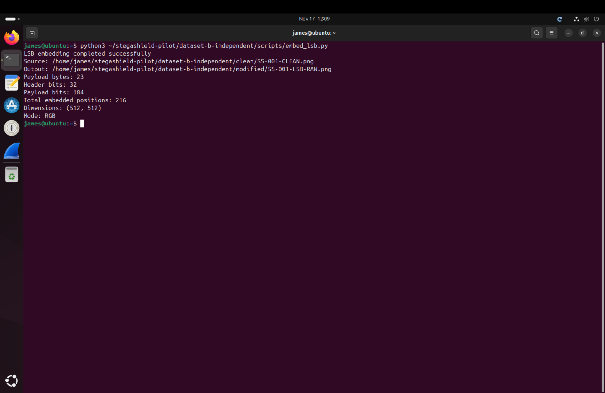
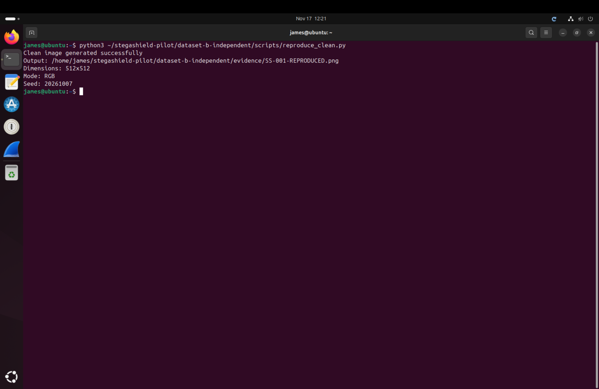
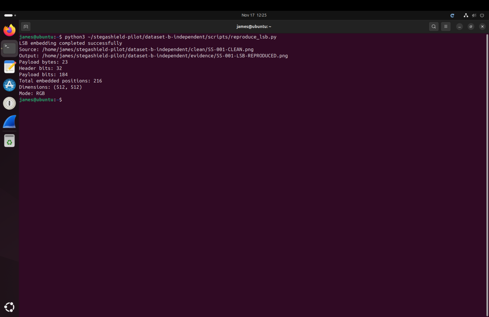
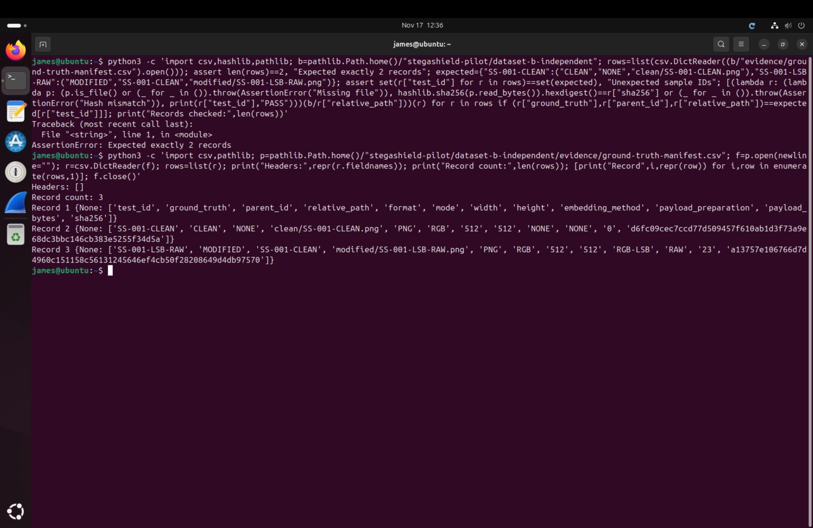
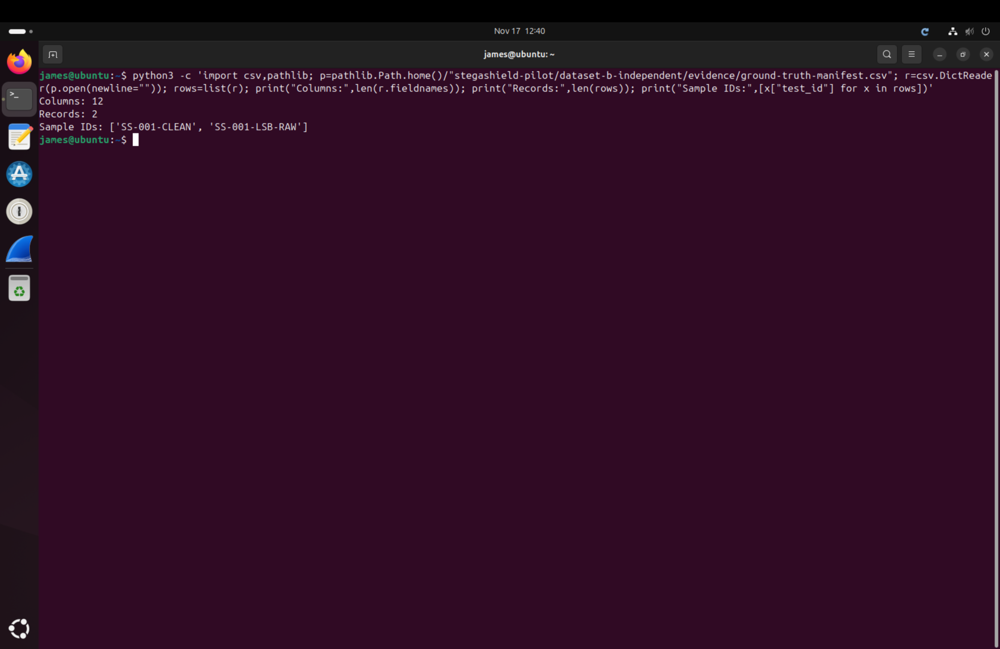
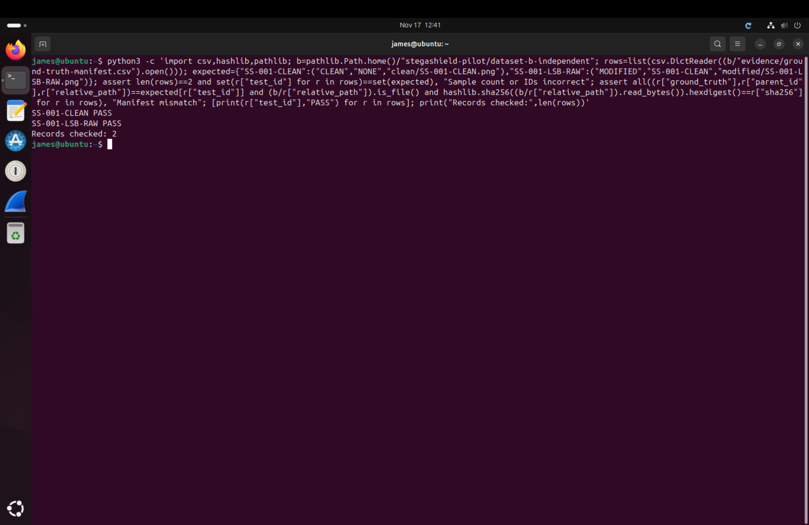
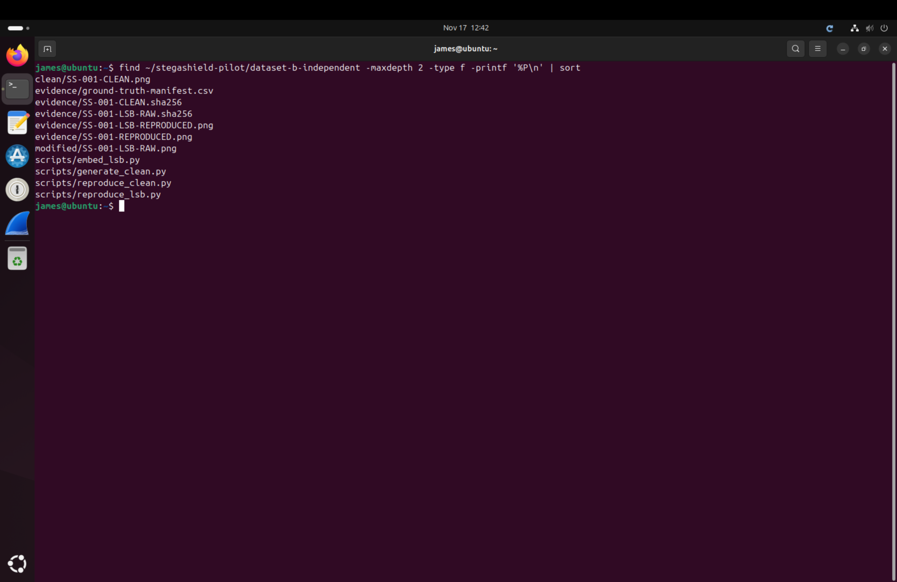

# Phase 02 — Independent Dataset & Ground Truth

**StegaShield Detection Validation Pilot**

**Focus:** Controlled image generation, genuine RGB-LSB embedding, independent ground-truth labels, and reproducibility.

[Back to Main Project](../README.md)

---

## 1. Objective

Before evaluating StegaShield's detection results, I needed image samples whose actual contents were known independently of the detection engine.

My objective was to create a controlled dataset containing a clean reference image and a corresponding image with genuinely embedded information.

I also wanted to establish reproducible generation methods, record sample provenance, and verify that the ground-truth manifest accurately represented the underlying files.

This would allow later model predictions to be compared against known ground truth rather than assumed labels.

## 2. Dataset Approach

I separated the evaluation into two dataset categories.

### Dataset A — External Reference

I examined the Stego-Images-Dataset available on Kaggle.

Reference: https://www.kaggle.com/datasets/marcozuppelli/stegoimagesdataset/data

This dataset had been identified during the project planning process as potentially associated with StegaShield's training and testing context.

I did not establish independent evidence of the product's exact training dataset or use Dataset A to claim independent detection performance.

### Dataset B — Independent Validation

I created Dataset B directly in the Ubuntu laboratory using Python and Pillow.

Dataset B contained two related samples:

| Sample ID | Ground Truth | Description |
|---|---|---|
| SS-001-CLEAN | CLEAN | Independently generated RGB reference image |
| SS-001-LSB-RAW | MODIFIED | Reference image modified using RGB-LSB embedding |

These labels were established from the sample-generation process, independently of StegaShield's predictions.

## 3. Dataset Workspace

The independent dataset was organized into four directories.

```text
dataset-b-independent/
├── clean/
│   └── SS-001-CLEAN.png
│
├── modified/
│   └── SS-001-LSB-RAW.png
│
├── scripts/
│   ├── generate_clean.py
│   ├── embed_lsb.py
│   ├── reproduce_clean.py
│   └── reproduce_lsb.py
│
└── evidence/
    ├── ground-truth-manifest.csv
    ├── SS-001-CLEAN.sha256
    ├── SS-001-LSB-RAW.sha256
    ├── SS-001-REPRODUCED.png
    ├── SS-001-LSB-REPRODUCED.png
    └── SS-001-reproducibility.sha256
```

Additional analysis-response artifacts were saved during later phases.

The original clean and modified samples were kept separate from their reproduced counterparts.

## 4. Clean Reference Image Generation

I created the clean reference image using `generate_clean.py`.

The script used Python's `random.Random` generator with a fixed seed to generate RGB pixel data.

### Verified Parameters

| Property | Value |
|---|---|
| Sample ID | SS-001-CLEAN |
| Width | 512 pixels |
| Height | 512 pixels |
| Color mode | RGB |
| Format | PNG |
| Random seed | 20261007 |
| Ground truth | CLEAN |
| Embedded payload | None |

The script generated pseudorandom channel values and constructed an RGB image using Pillow.

The fixed seed was important because it provided a repeatable generation procedure under compatible software conditions.

The script also used exclusive file creation to avoid silently overwriting existing evidence.

### Execution Result

I executed the generation script on Ubuntu.

It reported successful clean-image generation.


**Observation:** The script created `SS-001-CLEAN.png` with the expected dimensions, RGB mode, and seed.

**Limitation:** The carrier contains synthetic pseudorandom pixels rather than natural photographic content.

This distinction matters when interpreting the detector's later results.

## 5. RGB-LSB Modified Image Generation

After preserving the clean reference, I created a corresponding modified image using `embed_lsb.py`.

The script loaded the original RGB PNG and modified the least significant bits of consecutive RGB channel bytes.

### Controlled Payload

The embedded message was:

```text
STEGASHIELD_PILOT_SS001
```

The payload contained 23 bytes.

### Embedding Parameters

| Property | Value |
|---|---|
| Parent sample | SS-001-CLEAN |
| Modified sample | SS-001-LSB-RAW |
| Method | Sequential RGB-LSB replacement |
| Payload preparation | RAW |
| Payload length | 23 bytes |
| Length header | 32 bits |
| Payload data | 184 bits |
| Total embedded positions | 216 |
| Output format | RGB PNG |

### How the Embedding Worked

The script performed the following operations:

1. Opened the preserved clean RGB image.
2. Extracted the underlying RGB channel bytes.
3. Encoded the payload length as a 32-bit header.
4. Converted the raw payload into 184 binary bits.
5. Combined the header and payload bits.
6. Replaced the least significant bit of each corresponding channel byte.
7. Saved the modified image under a separate filename.

The relevant modification was:

```python
channels[index] = (channels[index] & 254) | int(bit)
```

This preserves the upper seven bits of each affected channel byte and replaces its least significant bit with the intended payload bit.

The script also checked that the image had sufficient embedding capacity.

### Execution Result

I executed the embedding script on Ubuntu.

The output confirmed successful RGB-LSB embedding, including the expected header size, payload size, and total embedding positions.



**Observation:** The modified PNG was created separately from the clean reference.

**Discovery:** The embedded data was written into actual image-channel bytes, rather than being appended to the PNG as unrelated trailing data.

This distinction was important for the later detection validation.

## 6. Reproducibility Testing

I created separate reproduction scripts to verify the dataset-generation methodology without overwriting the original samples.

### Clean Image Reproduction

The `reproduce_clean.py` script used the same generation logic, dimensions, RGB mode, and random seed as the original clean-image generator.

Its output destination was different:

`evidence/SS-001-REPRODUCED.png`

I executed the script successfully.



### Modified Image Reproduction

The `reproduce_lsb.py` script used the same clean source image, 23-byte payload, and RGB-LSB embedding procedure as the original embedding script.

It wrote to:

`evidence/SS-001-LSB-REPRODUCED.png`

I executed the script successfully.



### Reproduction Outcome

Both reproduction scripts executed successfully and produced their intended outputs.

Subsequent Phase 07 SHA-256 checks returned `OK` for all four original and reproduced image files.

This supports reproducibility of the controlled dataset under the tested environment.

It does not establish identical PNG output across every untested Python or Pillow version.

## 7. Ground-Truth Manifest

I created `ground-truth-manifest.csv` to document the relationship between the original clean image and the modified image.

The manifest recorded:

- Test ID
- Ground-truth classification
- Parent image ID
- Relative file path
- Image format
- Color mode
- Width and height
- Embedding method
- Payload preparation
- Payload size
- SHA-256 fingerprint

### Initial Validation Problem

My first validation attempt failed.

The CSV parser detected an unexpected structure: an empty header and three records instead of the intended two sample records.

This meant I could not reliably use the file as a validated ground-truth manifest.



### Correction

I inspected the CSV structure, corrected the malformed header arrangement, and checked the file again.

The corrected parser output showed:

```text
Columns: 12
Records: 2
Sample IDs: ['SS-001-CLEAN', 'SS-001-LSB-RAW']
```



### Final Manifest Verification

I then validated both sample records against their expected labels, parent relationships, relative paths, and SHA-256 fingerprints.

The verification returned:

```text
SS-001-CLEAN PASS
SS-001-LSB-RAW PASS
Records checked: 2
```



**Disposition:** Manifest validation issue resolved.

This was an important checkpoint because an incorrect or malformed ground-truth record could undermine the interpretation of later detection results.

## 8. Final Dataset Inventory

I inspected the completed Dataset B file structure.

The inventory confirmed the presence of:

- Original clean PNG
- Original modified PNG
- Ground-truth manifest
- Individual sample checksum records
- Reproduced clean PNG
- Reproduced modified PNG
- Reproducibility checksum record
- Four Python generation and reproduction scripts



The original images were kept separate from the reproduced images.

The scripts used separate output destinations to help protect existing evidence from accidental replacement.

## 9. Verified Findings

| Finding | Evidence | Outcome |
|---|---|---|
| Clean sample generation | Python execution output | Verified |
| Genuine RGB-LSB modification | Embedding script and execution output | Verified |
| Controlled 23-byte payload | Script and embedding output | Verified |
| Clean-image reproduction | Reproduction execution output | Verified |
| Modified-image reproduction | Reproduction execution output | Verified |
| Ground-truth manifest structure | CSV parser verification | 2 valid records |
| Ground-truth labels and hashes | Manifest validation output | 2/2 PASS |
| Original and reproduced image integrity | Later SHA-256 verification | 4/4 PASS |

The image-integrity checks were confirmed again during Phase 07. They should not be confused with detector predictions.

## 10. What I Discovered

### Discovery 01 — Ground Truth Must Be Independent

The clean and modified labels came from my controlled image-generation procedure, not from StegaShield.

This allowed later predictions to be evaluated against known sample conditions.

### Discovery 02 — Reproducibility Requires Controlled Inputs

A fixed generation seed, documented payload, consistent embedding method, and separate reproduction outputs made the experiment easier to verify.

### Discovery 03 — Data Preparation Errors Matter

The malformed CSV initially prevented successful manifest validation.

Correcting it and obtaining passing verification results ensured the recorded ground truth accurately represented the intended samples.

### Discovery 04 — Synthetic Images Have Limitations

The clean reference contained pseudorandom RGB values.

It was suitable for a controlled reproducibility experiment, but it was not representative of natural photography.

This limitation must be considered when interpreting StegaShield's later classifications.

## 11. Scope and Limitations

Phase 02 established dataset preparation and ground truth.

It did not independently establish StegaShield's detection accuracy or generalization.

The primary dataset contained only one clean and one corresponding modified sample.

No representative natural-image benchmark was completed in this phase.

The fixed seed supports deterministic data generation under compatible conditions but does not guarantee identical file encoding across every software environment.

The dataset does not provide evidence of malicious intent or data exfiltration.

## 12. Final Outcome

Phase 02 established a controlled, independently labeled Dataset B for StegaShield validation.

I generated the clean image, created a genuine RGB-LSB modification containing a 23-byte payload, executed both reproduction scripts, and validated the ground-truth manifest.

An initial CSV validation problem was identified and resolved before the final ground-truth checks passed.

The resulting dataset provided the known sample conditions needed for subsequent detector evaluation.

**Phase 02 Status: Independent Dataset and Ground Truth Verified.**

---

## Next Phase

[Phase 03 — StegaShield Deployment & Clean Baseline](../phase-03-deployment-baseline/README.md)

[Back to Main Project](../README.md)
