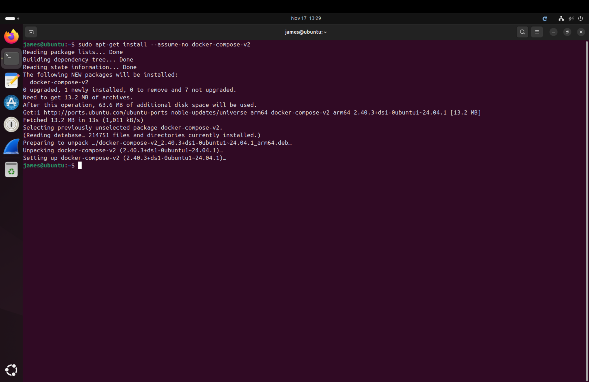
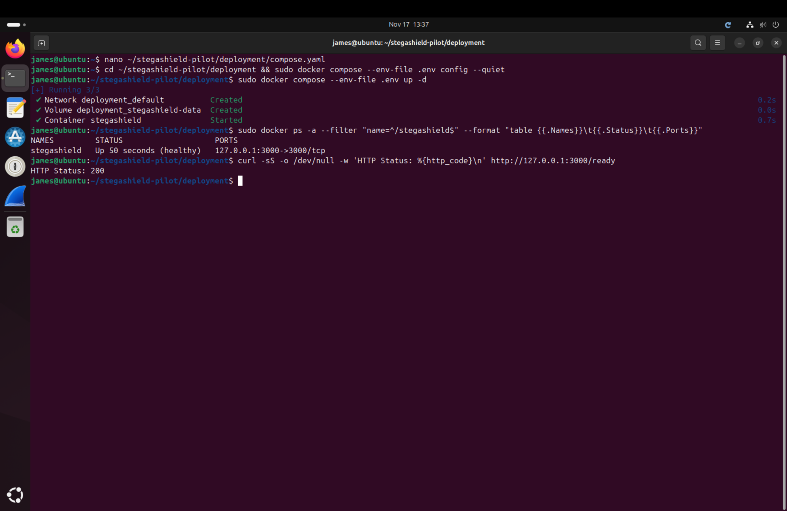
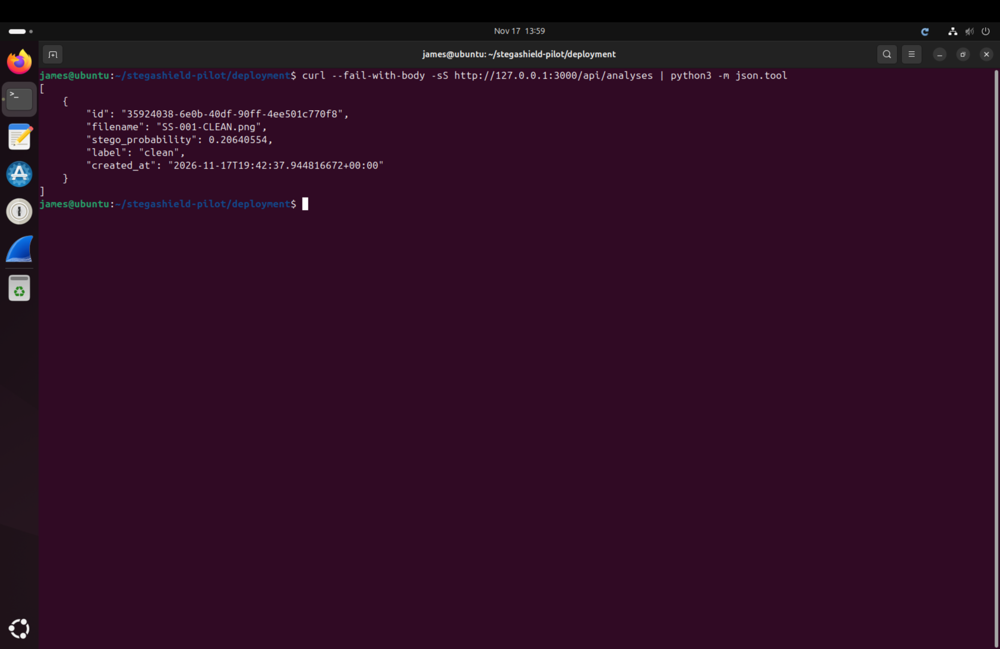
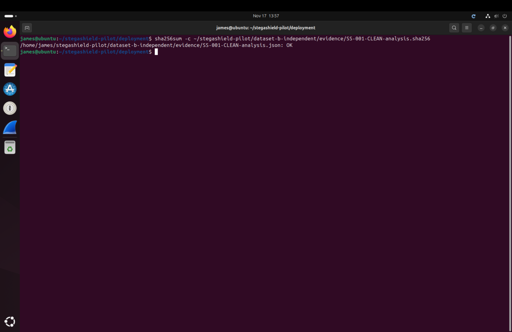
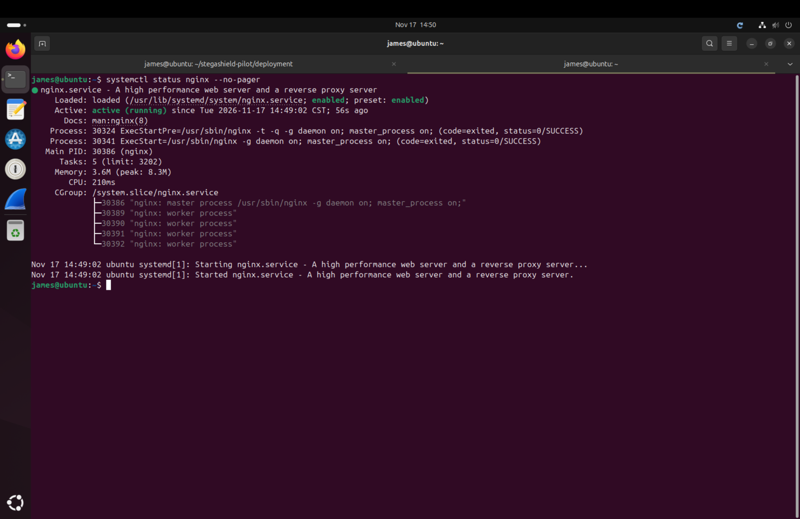
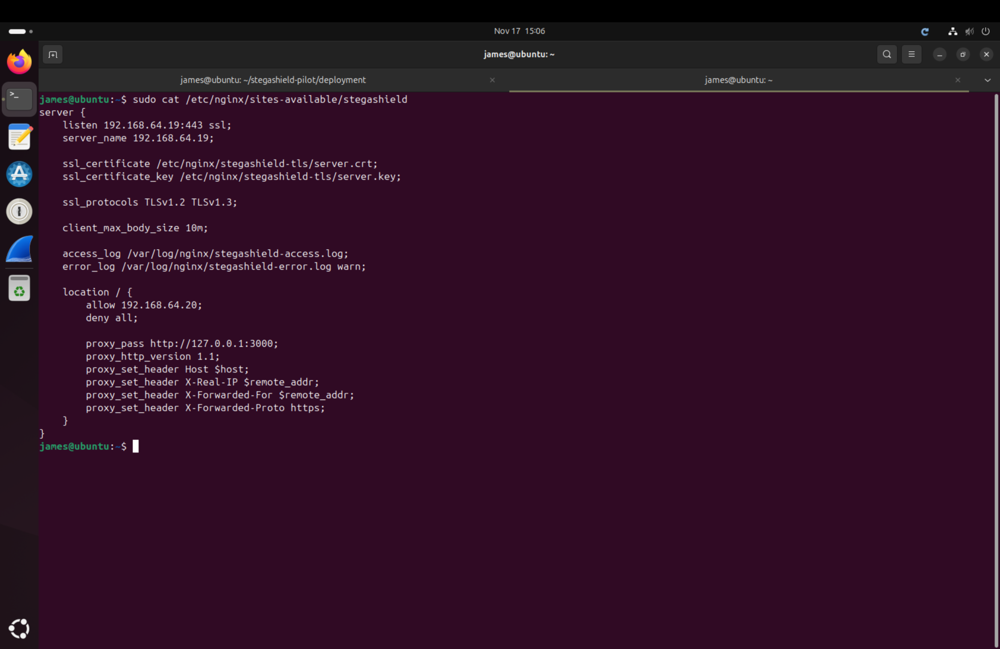
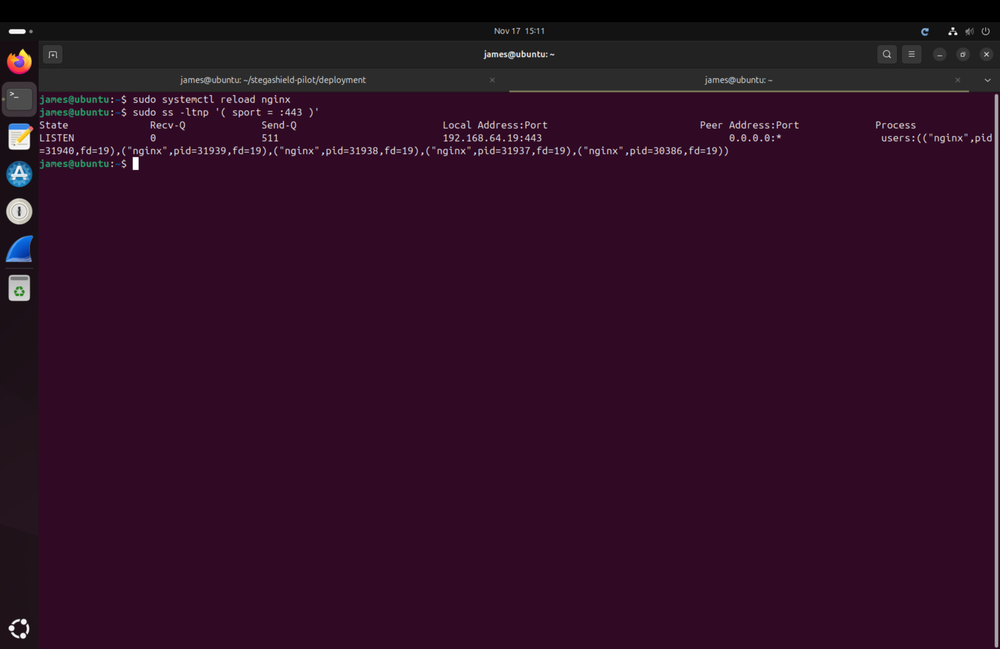
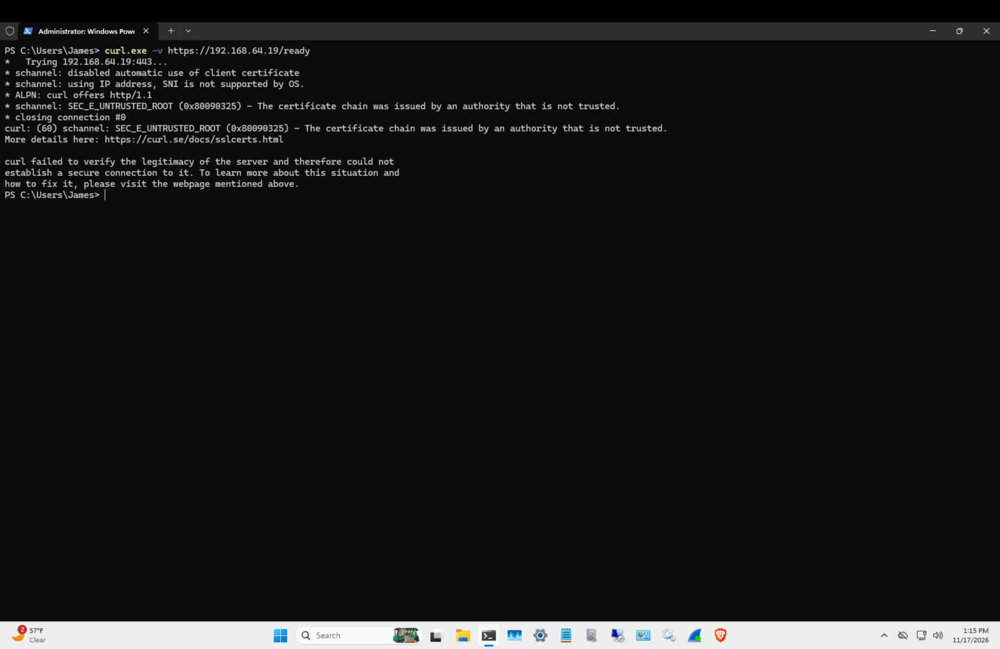

# Phase 03 — StegaShield Deployment & Clean Baseline

**StegaShield Detection Validation Pilot**

**Focus:** ARM64 deployment, Docker container verification, API readiness, clean-image classification, and HTTPS reverse-proxy configuration.

[Back to Main Project](../README.md)

---

## 1. Objective

After preparing my independent dataset in Phase 02, my next objective was to deploy StegaShield and verify that it could analyze a known-clean image.

I wanted to establish a working detection service before investigating genuine steganographic modifications.

The main objectives were to:

- Deploy StegaShield on Ubuntu ARM64.
- Verify Docker Compose compatibility.
- Confirm container startup and health.
- Test API readiness.
- Submit the independently labeled clean reference image.
- Record the actual model classification.
- Preserve the analysis response.
- Prepare controlled HTTPS access for subsequent SOC investigations.

The purpose of this phase was to establish a verified application baseline, not to measure overall detection accuracy.

## 2. Laboratory Environment

StegaShield was deployed on the Ubuntu ARM64 virtual machine used in the controlled laboratory.

| Component | Technology | Role |
|---|---|---|
| Host | Mac M2 | Laboratory workstation |
| Analysis server | Ubuntu 24.04 ARM64 | StegaShield deployment |
| Container runtime | Docker | Application execution |
| Deployment management | Docker Compose v2 | Container configuration |
| Detection engine | StegaShield | Image classification |
| Reverse proxy | Nginx 1.24 | HTTPS access |
| API testing | curl | Service and response verification |
| Test sample | SS-001-CLEAN.png | Known-clean reference |

The clean image was generated independently during Phase 02.

Its ground-truth label was CLEAN before it was submitted to StegaShield.

## 3. Docker Compose Preparation

I prepared the Docker environment and installed Docker Compose v2 on Ubuntu.

The installation output confirmed that the `docker-compose-v2` package had been installed.



I then used a Docker Compose configuration to deploy the StegaShield service.

### Verified Deployment Configuration

| Setting | Value |
|---|---|
| Service | stegashield |
| Container | stegashield |
| Image | 5iprojects/stegashield:latest |
| Platform | linux/arm64 |
| Host binding | 127.0.0.1:3000 |
| Container port | 3000 |
| Storage | Named Docker volume |
| Restart policy | no |
| Privilege restriction | no-new-privileges |
| Health check | HTTP /health |

The Compose file also configured:

- A required license token environment variable.
- Maximum upload size of 10,485,760 bytes.
- Maximum image dimension of 4,000.
- Inference timeout of 60 seconds.

The license token was supplied through the local deployment environment and is not included in this documentation.

### Security Observation

The container port was published only on Ubuntu's loopback interface.

The configured port mapping was:

```yaml
ports:
  - "127.0.0.1:3000:3000"
```

This avoided directly publishing the application port on Ubuntu's external network interfaces through the Docker port mapping.

A separate Nginx reverse proxy was configured to provide controlled network access.

## 4. Container Deployment and Verification

I validated the Docker Compose configuration and started the StegaShield container.

The deployment output confirmed creation of the required Docker network and named volume.

The StegaShield container started successfully.

I then inspected the running container using Docker.

The container reported a healthy status.

### API Readiness

I tested the application readiness endpoint through the local API.

The request targeted:

```text
http://127.0.0.1:3000/ready
```

The response returned:

```text
HTTP Status: 200
```



### Observation

The container was running, its health check was passing, and the application readiness endpoint responded successfully.

### Interpretation

The local deployment was available for controlled API testing.

However, successful service readiness did not establish that the model would correctly classify every image.

Detection behavior needed to be evaluated separately.

## 5. Known-Clean Image Baseline

After verifying the running application, I used the independently generated clean image from Dataset B as the baseline sample.

### Test Sample

| Property | Value |
|---|---|
| Sample ID | SS-001-CLEAN |
| Filename | SS-001-CLEAN.png |
| Ground truth | CLEAN |
| Format | PNG |
| Dimensions | 512 × 512 |
| Color mode | RGB |
| Embedded payload | None |

The image's known-clean status came from its controlled generation procedure, not from StegaShield's prediction.

I submitted the reference image to the detector and examined the recorded analysis result.

### Model Response

The saved analysis contained the following fields:

```json
{
  "id": "35924038-6e0b-40df-90ff-4ee501c770f8",
  "filename": "SS-001-CLEAN.png",
  "stego_probability": 0.20640554,
  "label": "clean",
  "created_at": "2026-11-17T19:42:37.944816672+00:00"
}
```

I also queried the application's `/api/analyses` endpoint to review the retained result.



### Result

| Field | Recorded Value |
|---|---|
| Ground truth | CLEAN |
| Model classification | clean |
| Steganography probability | 0.20640554 |
| Classification outcome | True Negative |

The model classified the known-clean reference correctly.

### Interpretation

This result established a successful clean-image baseline for the controlled sample.

It did not establish an overall true-negative rate, model accuracy, or performance across other clean images.

## 6. Analysis Evidence Integrity

After recording the clean-image response, I preserved its JSON analysis artifact.

The saved file was:

```text
SS-001-CLEAN-analysis.json
```

I also created a corresponding SHA-256 checksum record.

I then verified the saved JSON against the recorded checksum.

The terminal returned:

```text
SS-001-CLEAN-analysis.json: OK
```



### Observation

The saved analysis JSON matched its recorded SHA-256 fingerprint at the time of verification.

This provides an integrity check for the retained analysis response.

It does not independently prove the original submission timestamp or establish a complete forensic chain of custody.

## 7. Nginx Reverse-Proxy Preparation

The local StegaShield API was bound to `127.0.0.1:3000`.

To support controlled HTTPS access from the Windows endpoint, I installed and configured Nginx on Ubuntu.

I inspected its service status.

The output confirmed that Nginx was active and running.



### HTTPS Configuration

I prepared a server configuration that defined:

- HTTPS listening on Ubuntu TCP port 443.
- TLS 1.2 and TLS 1.3.
- A self-signed server certificate.
- A maximum request body size of 10 MB.
- Dedicated access and error logs.
- An IP allowlist for the Windows test endpoint.
- Reverse proxying to `127.0.0.1:3000`.

The relevant access-control and proxy directives were:

```nginx
location / {
    allow 192.168.64.20;
    deny all;

    proxy_pass http://127.0.0.1:3000;
    proxy_http_version 1.1;
}
```



### Security Interpretation

The configured architecture separated the external HTTPS entry point from the locally bound detection API.

The Nginx location restricted access by client IP address.

This provided a controlled network boundary for the pilot.

However, IP allowlisting is not equivalent to user authentication or mutual TLS.

## 8. HTTPS Listener Verification

After configuring Nginx, I reloaded the service and inspected its listening sockets.

The output showed Nginx listening on:

```text
192.168.64.19:443
```



### Observation

The HTTPS listener was active on the intended Ubuntu laboratory address.

This confirmed the configured listening endpoint.

Successful authenticated or certificate-trusted client communication required separate testing.

## 9. Windows TLS Certificate Trust Issue

During the initial Windows client connectivity test, I attempted to access the HTTPS readiness endpoint using `curl.exe`.

The request failed because Windows did not trust the server's self-signed certificate.

The recorded error included:

```text
SEC_E_UNTRUSTED_ROOT
```



### Investigation Finding

**Finding ID:** P03-F01

**Title:** Self-Signed TLS Certificate Not Trusted by Windows Client

**Observation:** The client rejected the server certificate during TLS validation.

**Interpretation:** HTTPS connectivity required the client to establish trust in the test certificate.

**Disposition at this checkpoint:** Certificate trust not yet established.

Certificate fingerprint verification, temporary client trust, successful HTTPS image submissions, and subsequent trust cleanup are documented with the later controlled-transfer workflow in Phase 06.

The initial TLS error should not be presented as a successful HTTPS connection.

## 10. Deployment Identity Verification

During the later reproducibility review, I inspected the locally installed StegaShield image and the deployed container.

The verified image identity was:

```text
sha256:64a6a378550f479c572c689bdb0af284cd81971e591a72077a6e74f7a97ea0e5
```

The inspected image architecture was `arm64`.

The running container referenced the same image ID.

### Significance

This identified the image used by the deployed container rather than relying only on the mutable `latest` tag.

It did not independently establish the model's internal weights, training dataset, or model architecture.

This image-identity check was performed during the later evidence-integrity review and is included here as subsequent deployment verification.

## 11. Investigation Findings

| Finding | Observation | Outcome |
|---|---|---|
| P03-F01 | Windows initially rejected the self-signed TLS certificate | Followed up during later HTTPS testing |
| P03-F02 | StegaShield container started and reported healthy | Verified |
| P03-F03 | Local readiness endpoint returned HTTP 200 | Verified |
| P03-F04 | Known-clean image classified as clean | True Negative |
| P03-F05 | Clean analysis JSON passed SHA-256 verification | Verified |
| P03-F06 | Nginx was active and HTTPS listener established | Verified |

## 12. What I Discovered

### Discovery 01 — Deployment Success Is Not Detection Accuracy

A healthy container and an HTTP 200 response demonstrate service availability.

They do not prove that the underlying detection model is accurate.

I needed to compare the model's output against independently established ground truth.

### Discovery 02 — A Known-Clean Baseline Is Essential

Testing the known-clean reference established how StegaShield responded before I examined the modified sample.

The clean image was correctly classified, providing a baseline for the subsequent investigation.

### Discovery 03 — API Exposure Should Be Controlled

Publishing the container API only on localhost and using a separate HTTPS reverse proxy allowed the pilot to restrict network access.

The configuration supported a more controlled testing environment.

### Discovery 04 — TLS Encryption and Certificate Trust Are Different

Nginx could be configured to serve HTTPS while the Windows client still rejected the certificate.

The initial certificate verification failure highlighted the distinction between providing an encrypted endpoint and establishing client trust.

## 13. Limitations

Phase 03 confirmed service availability and one correct clean-image classification.

It did not establish overall detection accuracy or generalization.

The baseline image was synthetic rather than a natural photograph.

The presence of an HTTPS listener did not independently prove that every client could successfully connect.

The initial Windows certificate trust failure required further investigation.

The internal model architecture and training data were not independently inspected.

## 14. Final Outcome

Phase 03 established a working StegaShield Docker deployment on Ubuntu ARM64.

I verified container health, confirmed local API readiness, submitted a known-clean image, and preserved the resulting classification.

The model correctly classified the clean reference image.

I also prepared the HTTPS reverse proxy and identified an initial Windows certificate trust problem that was addressed in the subsequent controlled-transfer workflow.

The main lesson was that successful deployment, correct classification, and secure client connectivity are separate verification requirements.

**Phase 03 Status: Docker Deployment and Clean Baseline Verified.**

**HTTPS Client Trust: Initially Failed; addressed during the later controlled-transfer investigation.**

---

## Next Phase

[Phase 04 — RGB-LSB Detection Validation](../phase-04-lsb-detection-validation/README.md)

[Back to Main Project](../README.md)
