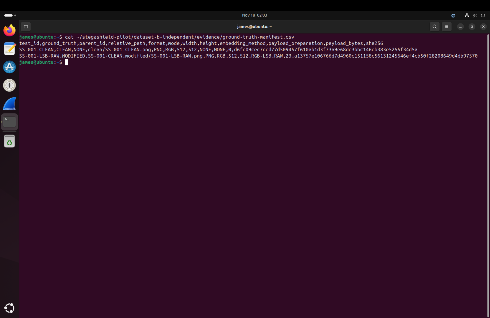
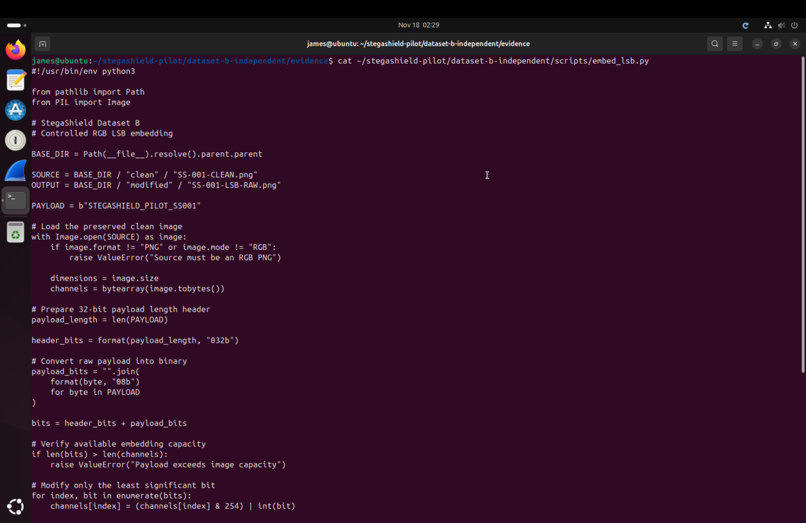
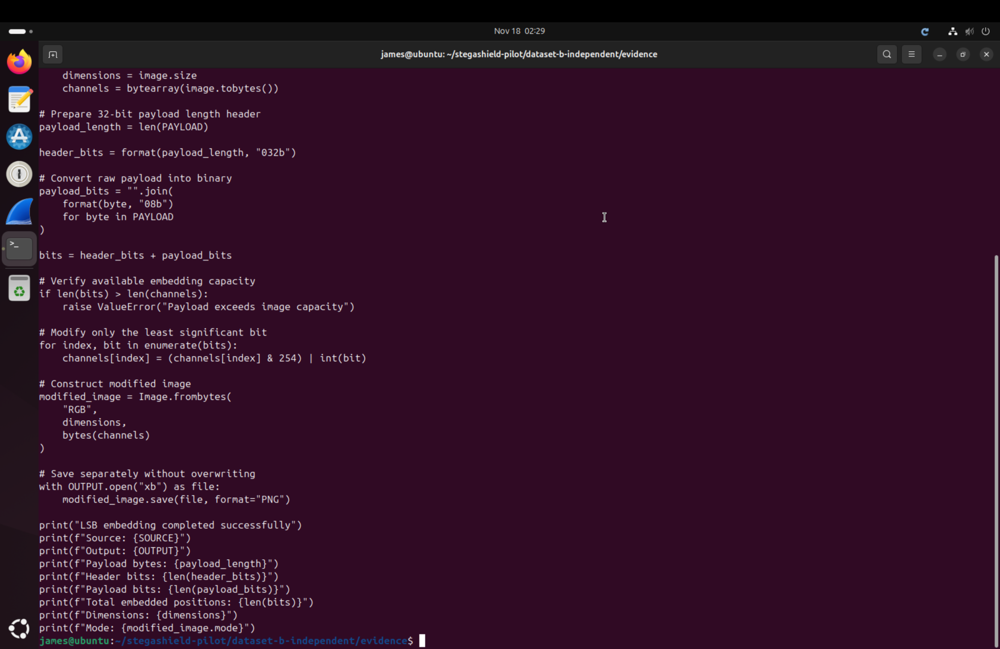
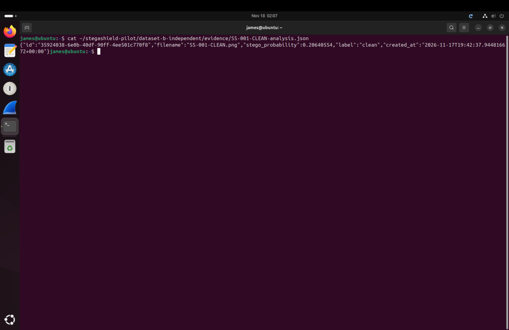
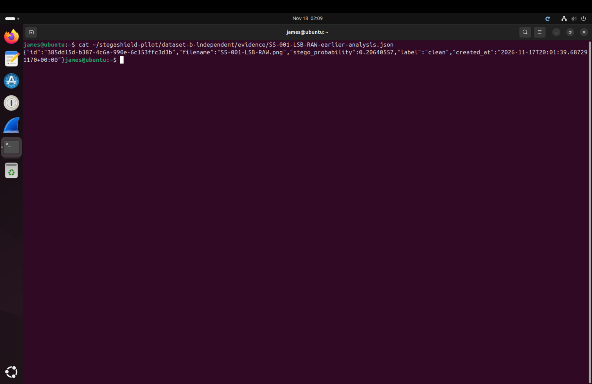
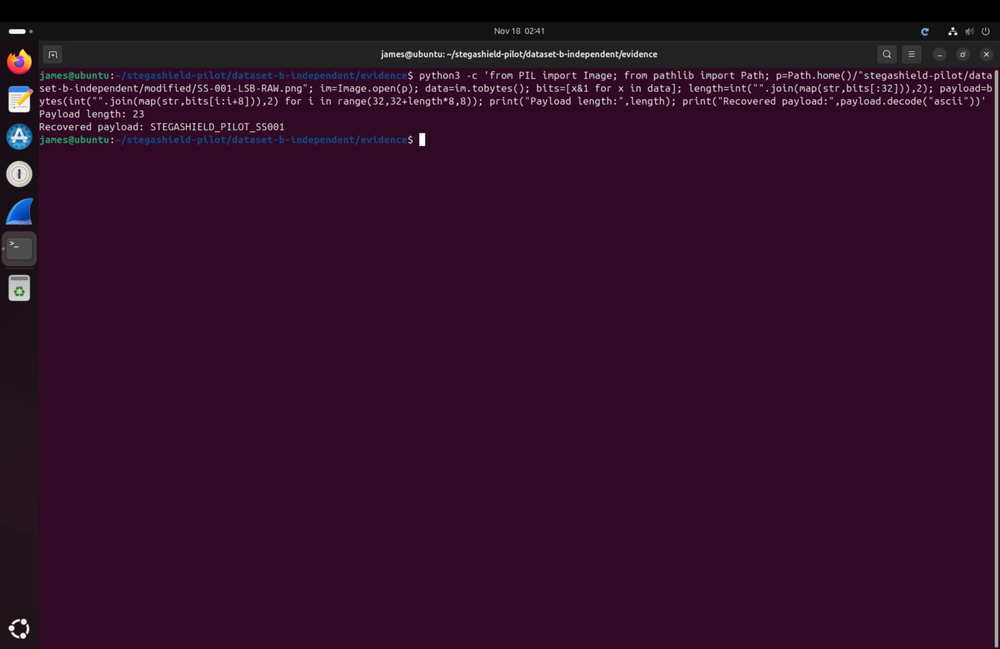

# Phase 04 — RGB-LSB Detection Validation

**StegaShield Detection Validation Pilot**

**Focus:** Controlled steganographic image testing, ground-truth comparison, false-negative investigation, and payload verification.

[Back to Main Project](../README.md)

---

## 1. Objective

After deploying StegaShield and establishing the known-clean baseline, I wanted to evaluate its behavior against an image containing genuinely embedded information.

The modified sample had already been prepared independently in Phase 02 using RGB least-significant-bit (LSB) embedding.

My objective was to submit this controlled modified image to StegaShield, inspect the model's classification, and compare the result against independently established ground truth.

I wanted to answer four questions:

1. Would StegaShield identify the RGB-LSB-modified image?
2. How would its prediction compare with the clean baseline?
3. Would repeated analysis records show the same result?
4. Could the embedded payload be independently verified?

The goal was to document the observed behavior accurately, not to assume that StegaShield would detect the modification.

## 2. Test Environment

The detection validation used the existing laboratory deployment.

| Component | Technology | Purpose |
|---|---|---|
| Analysis server | Ubuntu ARM64 | Host for StegaShield |
| Detection engine | StegaShield | Image classification |
| Container runtime | Docker | Application execution |
| API | StegaShield analysis endpoint | Image submission |
| Test dataset | Independent Dataset B | Known-clean and modified images |
| Image processing | Python and Pillow | Sample preparation and verification |
| Evidence format | JSON and SHA-256 | Prediction records and integrity checks |

The StegaShield deployment and initial clean-image baseline were established in Phase 03.

No additional detector or model was introduced during this validation.

## 3. Independent Ground Truth

The experiment used two related image samples.

Both samples originated from the same controlled dataset.

| Sample ID | Ground Truth | Description |
|---|---|---|
| SS-001-CLEAN | CLEAN | Independently generated clean RGB image |
| SS-001-LSB-RAW | MODIFIED | Clean image modified using RGB-LSB embedding |

The ground-truth labels were assigned from the sample-generation procedure, independently of StegaShield's model predictions.

I preserved the relationship between the original and modified samples in the ground-truth manifest.



### Verified Image Properties

| Property | Value |
|---|---|
| Format | PNG |
| Dimensions | 512 × 512 |
| Color mode | RGB |
| Parent sample | SS-001-CLEAN |
| Modified sample | SS-001-LSB-RAW |
| Embedding method | RGB-LSB |
| Payload preparation | RAW |
| Payload size | 23 bytes |

The modified sample had a different SHA-256 fingerprint from its clean parent.

This confirmed that the preserved files were not byte-identical.

The different hash alone did not establish the specific embedding mechanism; that was documented through the generation script and subsequent payload recovery.

## 4. RGB-LSB Embedding Methodology

The modified image was created using the `embed_lsb.py` script prepared during Phase 02.

The script loaded the known-clean image and extracted its RGB channel bytes.

It then encoded a controlled text payload into the least significant bits of those bytes.

### Embedded Payload

```text
STEGASHIELD_PILOT_SS001
```

The payload was 23 bytes long.

The script also encoded the payload length using a 32-bit header.

### Embedding Parameters

| Component | Value |
|---|---|
| Payload length | 23 bytes |
| Length header | 32 bits |
| Payload data | 184 bits |
| Total embedded positions | 216 |
| Modified channel property | Least significant bit |
| Output | SS-001-LSB-RAW.png |



### Actual Embedding Logic

The script used the following operation:

```python
channels[index] = (channels[index] & 254) | int(bit)
```

This operation clears the least significant bit of the selected channel byte and replaces it with the intended payload bit.

The script iterated through the 216 header and payload bits.



### Interpretation

The modified image contained changes to actual RGB pixel-channel values.

The method was not based on appending a marker to the end of the PNG file.

The script also checked that the available RGB channel capacity was sufficient before saving the modified image.

The original clean image was preserved separately.

## 5. Clean Baseline Comparison

Before evaluating the modified sample, I had already obtained a StegaShield analysis result for the known-clean image.

The saved result was:

```json
{
  "id": "35924038-6e0b-40df-90ff-4ee501c770f8",
  "filename": "SS-001-CLEAN.png",
  "stego_probability": 0.20640554,
  "label": "clean",
  "created_at": "2026-11-17T19:42:37.944816672+00:00"
}
```



### Baseline Interpretation

The clean image was correctly classified as `clean`.

Because the independently established ground truth was CLEAN, this was a true negative for the tested sample.

This result provided a baseline for comparison with the corresponding modified image.

It did not establish StegaShield's overall true-negative rate.

## 6. Modified Image Detection Test

I submitted the independently prepared RGB-LSB-modified image to StegaShield.

The submitted sample was:

```text
SS-001-LSB-RAW.png
```

Its independently established ground truth was MODIFIED.

I examined the model's saved JSON analysis response.

### Recorded Result

```json
{
  "id": "af3bfda8-b590-4617-a805-bac6f09dce29",
  "filename": "SS-001-LSB-RAW.png",
  "stego_probability": 0.20640557,
  "label": "clean",
  "created_at": "2026-11-17T20:05:19.979548339+00:00"
}
```


### Observation

StegaShield returned the classification:

```text
clean
```

The reported steganography probability was:

```text
0.20640557
```

### Investigation Finding

**Finding ID:** P04-F01

**Title:** RGB-LSB-Modified Image Classified as Clean

**Ground truth:** MODIFIED

**Model prediction:** clean

**Observed probability:** 0.20640557

**Classification outcome:** False Negative

### Interpretation

The sample was independently known to contain an RGB-LSB modification.

StegaShield classified that sample as clean.

Therefore, the result was a false negative for this controlled test.

This establishes a missed detection for the specific submitted sample.

It does not establish that StegaShield fails against all LSB embedding methods or other steganographic modifications.

## 7. Repeated Modified-Image Analysis

I also preserved an earlier StegaShield analysis record for the modified-image filename.

The earlier saved response contained:

```json
{
  "id": "385dd15d-b387-4c6a-990e-6c153ffc3d3b",
  "filename": "SS-001-LSB-RAW.png",
  "stego_probability": 0.20640557,
  "label": "clean",
  "created_at": "2026-11-17T20:01:39.687291170+00:00"
}
```



### Comparison

| Record | Prediction | Probability |
|---|---|---|
| Earlier modified-image analysis | clean | 0.20640557 |
| Later modified-image analysis | clean | 0.20640557 |

The two saved records had different analysis IDs and timestamps.

Both returned the same classification and reported probability.

### Interpretation

The records support repeatability of the observed prediction across these two saved analyses.

However, matching filenames and model outputs do not independently establish that the uploaded image bytes were identical in both submissions.

The preserved modified sample and its integrity checks support the documented test artifact, but the JSON records alone do not include input-image SHA-256 fingerprints.

## 8. Clean vs Modified Classification Comparison

I compared the clean baseline and modified-image results.

| Property | Clean Image | Modified Image |
|---|---|---|
| Ground truth | CLEAN | MODIFIED |
| Model prediction | clean | clean |
| Probability | 0.20640554 | 0.20640557 |
| Outcome | True Negative | False Negative |

The reported probability difference was:

```text
0.00000003
```

Both samples received the same `clean` classification despite their different ground-truth conditions.

### Key Observation

The model's reported probabilities were extremely close for this controlled image pair.

This observation does not reveal why the model failed to distinguish the samples.

The underlying model weights, learned features, training data, and decision process were not independently inspected.

## 9. Independent Payload Recovery

To strengthen the ground-truth verification, I later performed a read-only extraction of the modified PNG's RGB least-significant bits.

This verification was completed during the subsequent evidence-consolidation work.

The extraction procedure:

1. Opened the preserved modified PNG.
2. Read the RGB channel bytes.
3. Extracted the first 32 least-significant bits.
4. Decoded the payload-length header.
5. Read the corresponding payload bits.
6. Reconstructed the original payload bytes.

The terminal output confirmed:

```text
Payload length: 23
Recovered payload: STEGASHIELD_PILOT_SS001
```



### Verification Result

| Check | Result |
|---|---|
| Modified PNG read successfully | PASS |
| Payload-length header decoded | PASS |
| Extracted payload length | 23 bytes |
| Recovered message | STEGASHIELD_PILOT_SS001 |
| Recovered content matched intended payload | PASS |

### Significance

This verified that the preserved modified image contained the expected embedded message.

The finding was not based solely on a filename or a label in the ground-truth manifest.

The payload could be extracted from the actual image-channel data using the documented embedding format.

The extraction process did not modify the original image.

## 10. Detection Findings

| Finding ID | Observation | Outcome |
|---|---|---|
| P04-F01 | RGB-LSB-modified image classified as clean | False Negative |
| P04-F02 | Clean and modified samples received nearly identical probabilities | Verified |
| P04-F03 | Two saved modified-image analyses returned identical predictions | Verified |
| P04-F04 | Embedded 23-byte payload successfully recovered | Verified |

### Confirmed

- Independent ground-truth labels.
- Genuine RGB-LSB embedding methodology.
- Preserved clean and modified image artifacts.
- Correct clean-image classification.
- Incorrect modified-image classification.
- Two saved modified-image responses with identical reported probabilities.
- Successful recovery of the 23-byte embedded payload.

### Not Established

- Overall StegaShield detection accuracy.
- Detection recall across a representative dataset.
- Performance against natural photographic images.
- Performance against other steganography algorithms.
- Performance across different payload sizes.
- Exact internal cause of the false-negative result.

## 11. What I Discovered

### Discovery 01 — Successful Analysis Does Not Guarantee Correct Detection

StegaShield successfully processed the image and returned a valid JSON response.

However, the resulting classification did not match the independently established ground truth.

This demonstrated the importance of validating security predictions rather than treating successful API execution as proof of detection.

### Discovery 02 — Ground Truth Makes False Negatives Measurable

Because I created the modified sample independently, I already knew that it contained hidden information.

This allowed me to identify the incorrect `clean` prediction as a false negative.

Without independent ground truth, the result could have been incorrectly accepted as a clean image.

### Discovery 03 — Payload Recovery Strengthens Validation

The successful extraction of the original message provided additional confirmation that the preserved modified image contained the intended payload.

This made the detection finding more defensible.

### Discovery 04 — Similar Probabilities Require Careful Interpretation

The clean and modified images received almost identical reported probabilities.

This is an observation about the tested sample pair.

It does not establish the model's broader behavior or explain its internal decision process.

## 12. Scope and Limitations

This experiment used one synthetic clean image and one corresponding RGB-LSB-modified image.

The clean carrier consisted of pseudorandom RGB pixels rather than natural photographic content.

The embedded payload was small and used a single deterministic embedding method.

Therefore, the result cannot be generalized to all steganographic images.

The two saved modified-image analysis records demonstrate identical reported predictions but do not independently prove input-byte identity for both submissions.

The payload recovery verification was completed later and is documented with its actual evidence context.

No malicious activity, data exfiltration, or production compromise was demonstrated.

## 13. Final Outcome

Phase 04 established a confirmed false-negative result for the controlled RGB-LSB-modified image.

StegaShield correctly classified the clean reference but returned `clean` for the corresponding modified image containing a 23-byte payload.

Two saved modified-image analysis records reported the same probability and classification.

The embedded message was subsequently recovered directly from the preserved modified PNG, strengthening the ground-truth verification.

The main lesson was that detection validation requires independent ground truth, inspection of actual model responses, and evidence that supports the reported conclusions.

**Phase 04 Status: Controlled RGB-LSB Detection Validation Completed.**

**Primary Finding: False Negative for the Tested Modified Sample.**

---

## Next Phase

[Phase 05 — Error Analysis & Generalization Limits](../phase-05-error-analysis/README.md)

[Back to Main Project](../README.md)
