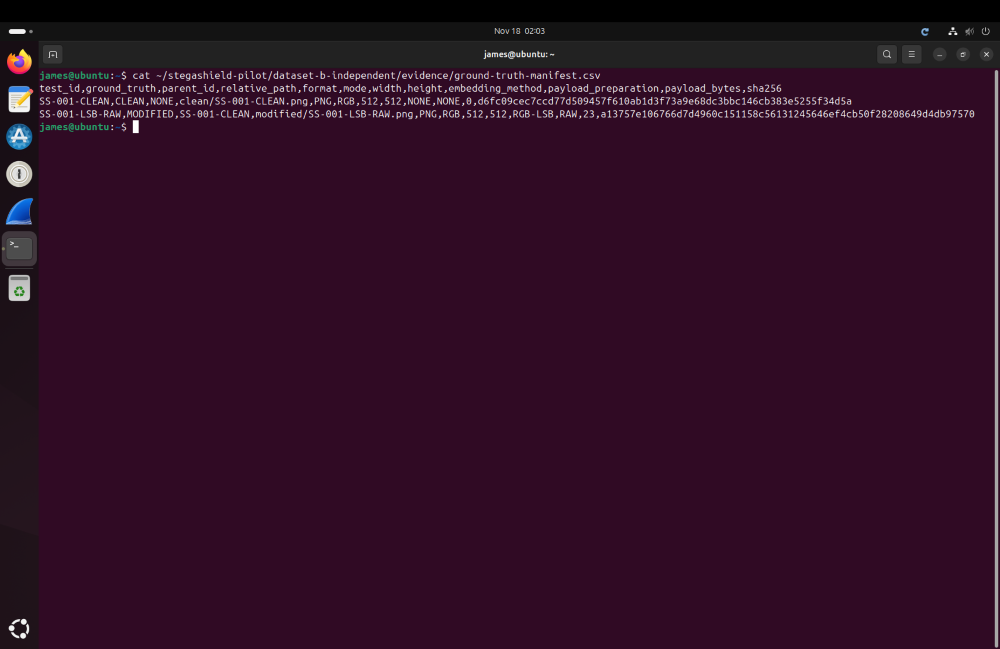
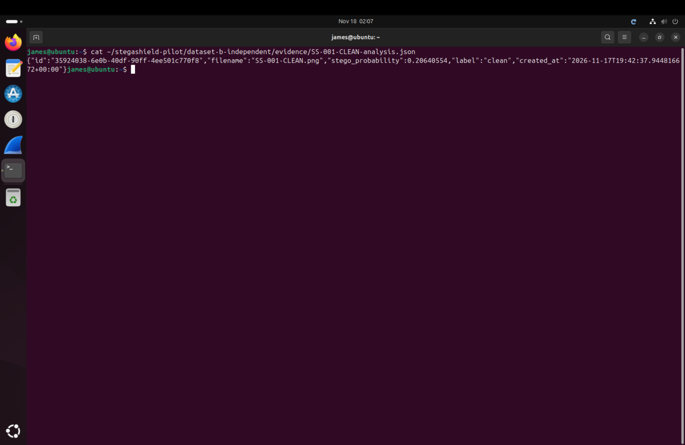
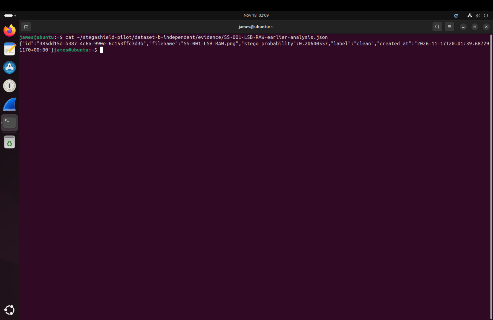
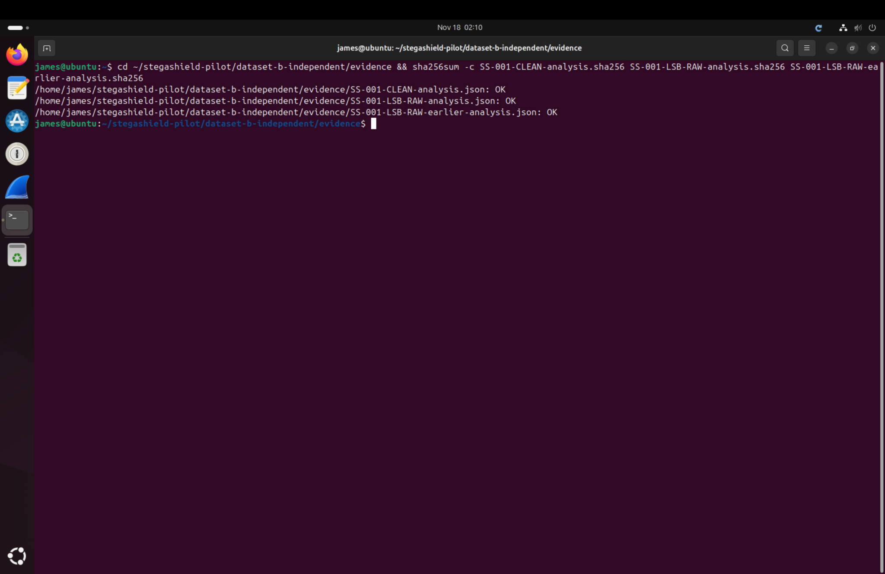
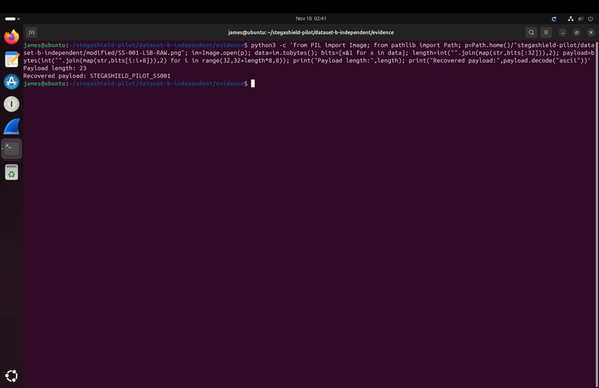

# Phase 05 — Error Analysis & Generalization Limits

**StegaShield Detection Validation Pilot**

**Focus:** False-negative investigation, model response comparison, reproducibility of observed predictions, and limitations of independent detection testing.

[Back to Main Project](../README.md)

---

## 1. Objective

After StegaShield classified my RGB-LSB-modified image as clean, I wanted to investigate the result rather than immediately conclude that the detection engine was unreliable.

My objective was to compare the recorded predictions, verify the supporting evidence, and determine what conclusions were justified by the experiment.

The investigation focused on five questions:

1. How did the clean and modified image predictions compare?
2. What was the difference between their reported steganography probabilities?
3. Did the saved modified-image analyses return consistent results?
4. Was the observed false negative supported by independent ground truth?
5. What limitations prevented broader conclusions about StegaShield's performance?

This was an analysis of the existing controlled experiment, not a new benchmark involving additional image samples.

## 2. Investigation Context

The experiment used the independently generated Dataset B established in Phase 02.

The two samples shared the same clean-image origin.

| Sample | Ground Truth | Description |
|---|---|---|
| SS-001-CLEAN.png | CLEAN | Synthetic RGB reference image |
| SS-001-LSB-RAW.png | MODIFIED | Corresponding image containing a controlled RGB-LSB payload |

Both images were 512 × 512 RGB PNG files.

The clean reference was generated using a fixed Python random seed.

The modified image was created by embedding a 23-byte payload into the least significant bits of consecutive RGB channel bytes.

Ground-truth labels were established independently of StegaShield.



### Why Ground Truth Matters

A detection engine's prediction cannot be used as the sole basis for deciding whether its prediction is correct.

Because I controlled the image-generation process, I knew which sample was clean and which contained embedded information before examining StegaShield's results.

This allowed the incorrect classification to be identified as a false negative.

## 3. Clean Image Analysis

I reviewed the saved JSON response for the known-clean reference image.

The analysis record contained:

```json
{
  "id": "35924038-6e0b-40df-90ff-4ee501c770f8",
  "filename": "SS-001-CLEAN.png",
  "stego_probability": 0.20640554,
  "label": "clean",
  "created_at": "2026-11-17T19:42:37.944816672+00:00"
}
```



### Observation

The model returned:

- Ground truth: CLEAN
- Predicted label: clean
- Steganography probability: 0.20640554

The prediction matched the independently established ground truth.

### Classification

**True Negative**

This was a correct classification for the tested clean image.

However, a single correct prediction does not establish an overall true-negative rate.

## 4. Modified Image Analysis

I then reviewed the saved JSON response for the RGB-LSB-modified sample.

The analysis record contained:

```json
{
  "id": "af3bfda8-b590-4617-a805-bac6f09dce29",
  "filename": "SS-001-LSB-RAW.png",
  "stego_probability": 0.20640557,
  "label": "clean",
  "created_at": "2026-11-17T20:05:19.979548339+00:00"
}
```


### Observation

The model returned:

- Ground truth: MODIFIED
- Predicted label: clean
- Steganography probability: 0.20640557

The prediction did not match the established ground truth.

### Classification

**False Negative**

The image contained an RGB-LSB modification, but StegaShield classified it as clean.

### Finding P05-F01 — Missed RGB-LSB Detection

**Observed condition:** The image contained a controlled steganographic payload.

**Expected classification:** A positive steganography detection, assuming the detector's intended scope includes this method.

**Actual classification:** clean

**Disposition:** Confirmed false negative for the tested sample.

**Limitation:** The evidence does not establish the internal reason for the model's prediction.

## 5. Probability Comparison

I compared the model's reported probabilities for both samples.

| Property | Clean Image | Modified Image |
|---|---|---|
| Ground truth | CLEAN | MODIFIED |
| Prediction | clean | clean |
| Steganography probability | 0.20640554 | 0.20640557 |
| Outcome | True Negative | False Negative |

### Probability Difference

```text
0.20640557 - 0.20640554 = 0.00000003
```

The modified image received a steganography probability only 0.00000003 higher than the clean image.

The two recorded probabilities were nearly identical.

### Interpretation

For this controlled image pair, StegaShield's reported scores showed almost no separation between the clean and modified samples.

This is a direct observation from the model responses.

It does not establish why the scores were similar.

I did not independently inspect the model weights, training data, learned image features, or internal decision process.

Therefore, I cannot attribute the result to a specific model architecture weakness, preprocessing issue, or training-data problem.

## 6. Repeated Modified-Image Analysis

I also preserved an earlier analysis record for the modified-image filename.

The earlier response contained:

```json
{
  "id": "385dd15d-b387-4c6a-990e-6c153ffc3d3b",
  "filename": "SS-001-LSB-RAW.png",
  "stego_probability": 0.20640557,
  "label": "clean",
  "created_at": "2026-11-17T20:01:39.687291170+00:00"
}
```



### Recorded Comparison

| Analysis Record | Prediction | Probability |
|---|---|---|
| Earlier modified-image analysis | clean | 0.20640557 |
| Later modified-image analysis | clean | 0.20640557 |

The saved responses had different analysis IDs and timestamps.

Both recorded the same predicted label and probability.

### Finding P05-F02 — Consistent Recorded Predictions

The two saved modified-image analyses produced identical reported classifications and probabilities.

This supports consistency of the observed result across those records.

However, the JSON records do not contain SHA-256 fingerprints of the uploaded image bytes.

Consequently, matching filenames and predictions do not independently prove input-byte identity across the two submissions.

This distinction is important when documenting reproducibility.

## 7. Analysis Evidence Integrity

Before relying on the saved model responses, I verified their integrity against the recorded SHA-256 checksum files.

The three checked artifacts were:

```text
SS-001-CLEAN-analysis.json
SS-001-LSB-RAW-analysis.json
SS-001-LSB-RAW-earlier-analysis.json
```

The terminal returned `OK` for all three files.



### Verification Results

| Artifact | Integrity Result |
|---|---|
| Clean analysis JSON | PASS |
| Modified analysis JSON | PASS |
| Earlier modified analysis JSON | PASS |

All three saved analysis records matched their recorded checksums.

### Interpretation

This verified the integrity of the retained JSON artifacts against their corresponding checksum records at the time of testing.

It does not independently establish when the responses were originally generated or prove that the upstream model itself was unchanged.

The checks support evidence preservation, not a complete forensic chain of custody.

## 8. Independent Payload Verification

The false-negative finding depended on establishing that the modified image genuinely contained hidden information.

The RGB-LSB embedding methodology was documented in Phase 02 and reviewed in Phase 04.

During the subsequent evidence verification, I also performed a read-only extraction of the preserved modified PNG.

The extraction read the least significant bits of the RGB channel bytes.

The first 32 bits encoded the payload length.

The following bits encoded the payload itself.

The terminal returned:

```text
Payload length: 23
Recovered payload: STEGASHIELD_PILOT_SS001
```



### Finding P05-F03 — Ground Truth Supported by Recovery

The recovered message matched the payload defined in the embedding script.

This supported the established MODIFIED ground truth independently of StegaShield's classification.

The recovery was performed during later evidence verification, not as an additional model benchmark.

The original modified PNG was not changed by this read-only procedure.

## 9. Error Analysis

The experiment established the following outcomes:

| Actual Condition | Predicted Condition | Outcome |
|---|---|---|
| CLEAN | clean | True Negative |
| MODIFIED | clean | False Negative |

The controlled dataset therefore contained:

- One correctly classified clean image.
- One incorrectly classified modified image.

The model did not return a positive classification for either of the two evaluated sample conditions.

### What Can Be Concluded

The tested deployment missed the controlled RGB-LSB modification.

The modified image carried a recoverable 23-byte payload.

Both saved analyses of the modified-image filename recorded the same false-negative classification.

The clean and modified samples received almost identical reported probabilities.

### What Cannot Be Concluded

The experiment does not establish StegaShield's overall accuracy, recall, precision, specificity, or false-negative rate on a representative population.

Although the two sample outcomes are known, reporting broad model-performance percentages from one clean/modified pair would be misleading.

No statistically representative benchmark was conducted.

## 10. Generalization Limitations

Several limitations affect how the results should be interpreted.

### 10.1 Small Sample Size

The primary validation involved one clean image and one corresponding modified image.

This is insufficient to characterize overall detector performance.

### 10.2 Synthetic Image Content

The clean reference was generated using pseudorandom RGB pixel values.

It was not a natural photograph.

A detector may behave differently when processing real-world photographic content.

This possibility was not independently tested.

### 10.3 Single Embedding Method

The modified image used sequential RGB-LSB replacement.

The experiment did not evaluate other embedding approaches or steganographic algorithms.

### 10.4 Single Payload Size

The embedded message was 23 bytes.

Different payload sizes and embedding densities were not evaluated in this test pair.

### 10.5 Limited Model Internals

The model's internal architecture, training data, weights, and feature representations were not independently audited.

The observed prediction cannot be attributed to a specific internal weakness.

### 10.6 Input Fingerprint Attribution

The saved analysis JSON files recorded filenames, classifications, probabilities, identifiers, and timestamps.

They did not independently record the SHA-256 fingerprint of each uploaded input.

Future evaluations should associate each request and response with an exact input-image hash.

## 11. Key Discoveries

### Discovery 01 — Ground Truth Is Essential

Without independently established sample labels, I could have accepted the modified image's `clean` prediction without recognizing the detection failure.

### Discovery 02 — Similar Scores Can Conceal Different Sample Conditions

The clean and modified samples had different ground-truth conditions, yet their reported probabilities were almost identical.

The scores alone did not distinguish them in this experiment.

### Discovery 03 — Repeated Predictions Are Not the Same as General Accuracy

Two saved analyses returned the same modified-image result.

That supports consistency across the records, but it does not establish broader model reliability.

### Discovery 04 — Integrity and Recoverability Strengthen Evidence

Checksum verification and successful payload recovery strengthened the evidence supporting the false-negative finding.

They did not explain the underlying model behavior.

### Discovery 05 — Testing Limitations Must Be Reported

A confirmed missed detection is a meaningful research finding.

However, it must be reported within the limits of the tested sample, embedding method, and environment.

## 12. Recommendations for Future Research

A broader independent assessment should consider:

1. Testing a larger number of independently labeled clean and modified images.
2. Including natural photographs as well as synthetic images.
3. Varying the payload size and embedding density.
4. Evaluating additional steganographic embedding techniques.
5. Recording the exact SHA-256 hash of every submitted image alongside its response.
6. Using a predefined evaluation protocol before calculating aggregate detection metrics.
7. Comparing results across a known and fixed application image and model version.

These are recommendations, not claims that the additional experiments were completed.

## 13. Final Findings

| Finding ID | Description | Status |
|---|---|---|
| P05-F01 | RGB-LSB-modified image classified as clean | Confirmed |
| P05-F02 | Two saved modified-image responses reported identical results | Verified |
| P05-F03 | Original 23-byte payload successfully recovered | Verified |
| P05-F04 | Three saved analysis JSON files passed SHA-256 checks | Verified |
| P05-F05 | Broader detection accuracy remains unknown | Documented limitation |

## 14. Final Outcome

Phase 05 analyzed the false-negative result observed during controlled StegaShield testing.

The known-clean image was correctly classified, while the corresponding RGB-LSB-modified image was classified as clean.

The reported steganography probabilities differed by only 0.00000003.

Two saved analyses of the modified-image filename returned the same prediction and probability.

Subsequent payload recovery and checksum verification strengthened the supporting evidence.

However, the small synthetic dataset, single embedding method, and lack of independent model-internal visibility prevented broader conclusions about detection performance.

The main lesson was that meaningful error analysis requires independent ground truth, preserved model responses, evidence verification, and clearly stated limitations.

**Phase 05 Status: Error Analysis Completed.**

**Primary Finding: Confirmed False Negative for the Controlled RGB-LSB Sample.**

**General Model Performance: Not Established.**

---

## Next Phase

[Phase 06 — HTTPS & SOC Telemetry Correlation](../phase-06-soc-telemetry-correlation/README.md)

[Back to Main Project](../README.md)

