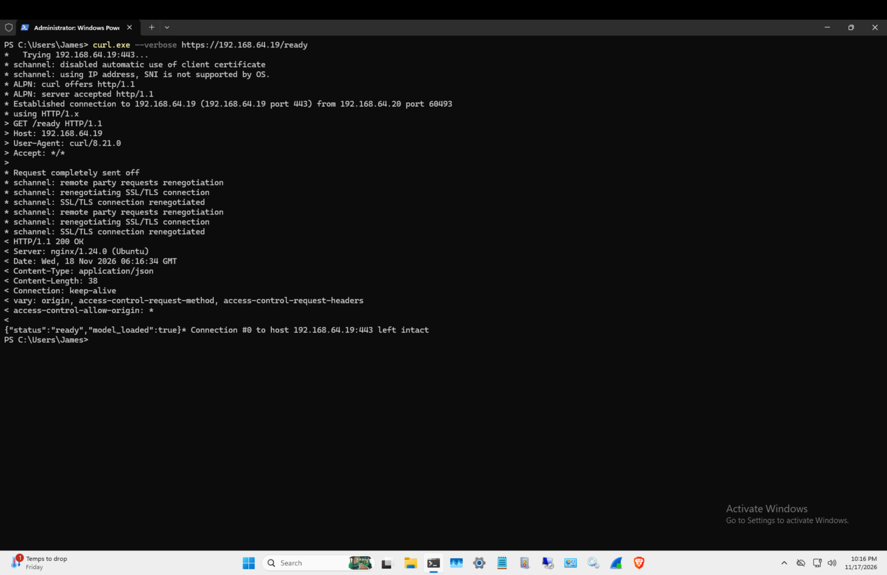
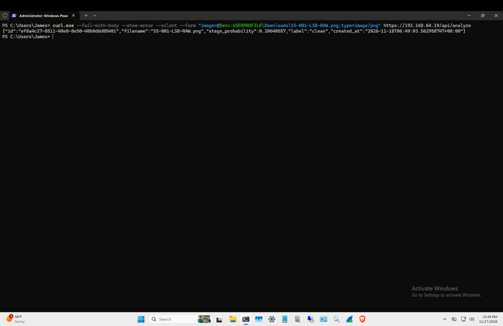
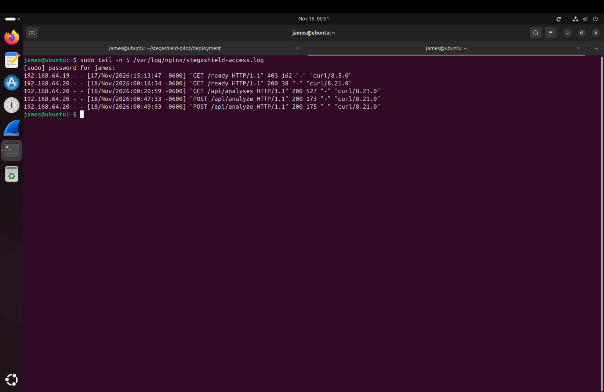
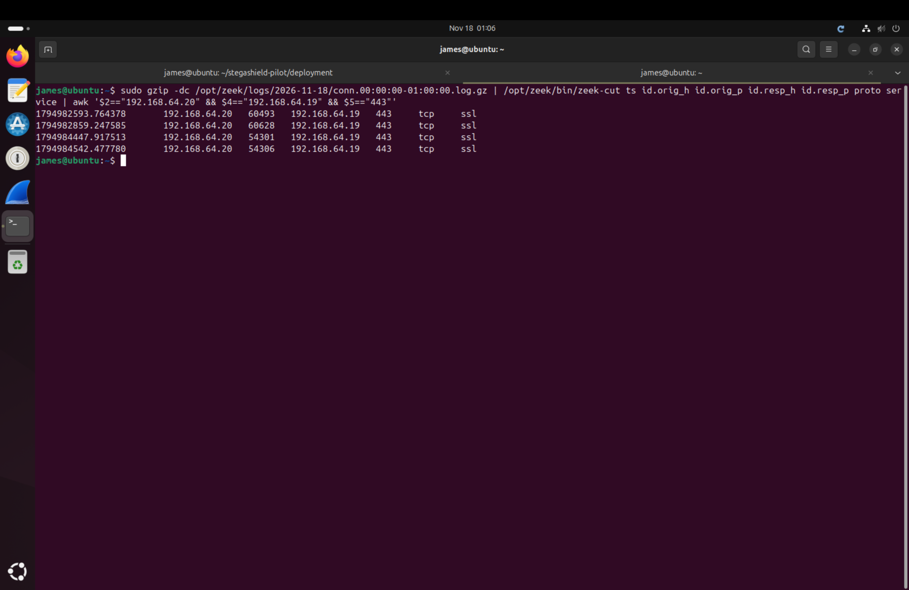
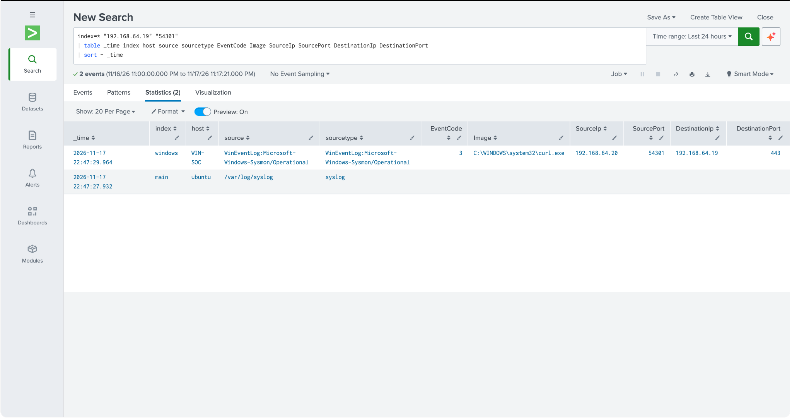
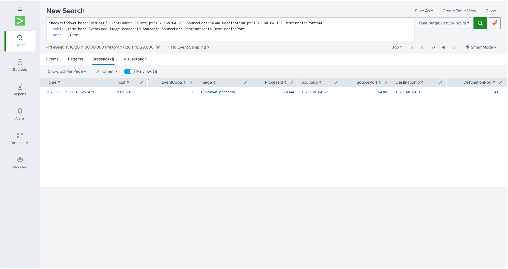
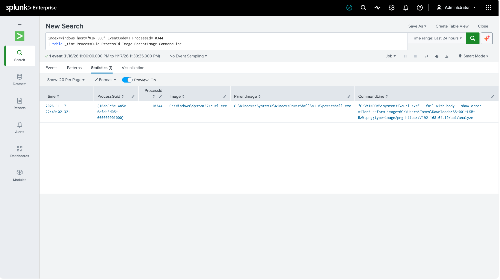

# Phase 06 — HTTPS & SOC Telemetry Correlation

**StegaShield Detection Validation Pilot**

**Focus:** Controlled HTTPS image submissions, endpoint investigation, network telemetry correlation, process attribution, and evidence-driven SOC analysis.

[Back to Main Project](../README.md)

---

## 1. Objective

After validating StegaShield's classification behavior, I wanted to investigate the image-submission activity from a SOC analyst's perspective.

My goal was to determine whether the activity could be reconstructed using telemetry collected from different parts of the laboratory.

Instead of relying only on StegaShield's API response, I wanted to correlate evidence from the Windows endpoint, the network sensor, the reverse proxy, and the SIEM.

The investigation focused on five questions:

1. Could the Windows endpoint submit images to StegaShield over HTTPS?
2. Would Nginx record the corresponding application requests?
3. Would Zeek capture the encrypted network connections?
4. Would Sysmon identify the originating Windows processes?
5. Could Splunk help reconstruct process attribution when individual telemetry fields were incomplete?

This was authorized laboratory testing using independently generated image samples.

It was not a simulated intrusion, production incident, or demonstration of malicious data exfiltration.

## 2. Laboratory Environment

The investigation used the existing StegaShield laboratory.

| Component | Technology | Role |
|---|---|---|
| Host workstation | Mac M2 | Splunk Enterprise and lab management |
| Windows endpoint | WIN-SOC, Windows 11 ARM64 | Controlled image submissions |
| Endpoint monitoring | Sysmon | Process and network telemetry |
| SIEM | Splunk Enterprise | Centralized Windows event investigation |
| Linux server | Ubuntu ARM64 | StegaShield and network monitoring |
| Reverse proxy | Nginx | HTTPS requests and access logs |
| Network sensor | Zeek | Network connection metadata |
| Detection engine | StegaShield | Image classification |
| Client utility | curl.exe | HTTPS image submissions |

### Verified Network Addresses

| System | IP Address |
|---|---|
| WIN-SOC | 192.168.64.20 |
| Ubuntu StegaShield server | 192.168.64.19 |

### Application Traffic Flow

```text
WIN-SOC Windows 11
192.168.64.20
       |
       | HTTPS :443
       v
Ubuntu Nginx
192.168.64.19
       |
       | HTTP reverse proxy
       v
StegaShield API
127.0.0.1:3000
```

Windows Sysmon events were forwarded to Splunk Enterprise running on macOS.

Zeek monitored network activity on Ubuntu.

Nginx independently recorded HTTPS application requests.

These sources were investigated together, but their logs were not all ingested into one centralized SIEM index.

## 3. HTTPS Connectivity Preparation

The StegaShield application was already running locally on Ubuntu.

Nginx provided a controlled HTTPS entry point on TCP port 443.

The reverse proxy configuration permitted the WIN-SOC endpoint address and denied other client addresses at the configured location.

### TLS Certificate Trust

The server used a self-signed TLS certificate for this isolated pilot.

During initial connectivity testing, Windows rejected the certificate because it was not trusted.

The error included:

```text
SEC_E_UNTRUSTED_ROOT
```

I investigated the certificate and verified its SHA-256 fingerprint across the Ubuntu and Windows systems.

After confirming the expected certificate identity, I temporarily trusted the certificate in the Windows CurrentUser certificate store for the authorized pilot.

I subsequently removed that temporary trust entry during cleanup.

This was a controlled laboratory trust decision, not a recommendation to trust arbitrary self-signed certificates.

### Verified HTTPS Readiness

I tested the server from WIN-SOC using:

```powershell
curl.exe --verbose https://192.168.64.19/ready
```

The server returned:

```text
HTTP/1.1 200 OK
```

The response included:

```json
{
  "status": "ready",
  "model_loaded": true
}
```



### Observation

Windows successfully established an HTTPS connection to the Nginx endpoint.

The StegaShield readiness response confirmed that the application reported itself ready and its model loaded.

### Interpretation

The tested client-to-server HTTPS path was operational.

This did not establish that every client was authorized or that the detector would correctly classify submitted images.

## 4. Controlled Image Submissions

I submitted the independent Dataset B images from WIN-SOC using `curl.exe` in PowerShell.

The endpoint was:

```text
https://192.168.64.19/api/analyze
```

The two test samples were:

| Sample | Ground Truth |
|---|---|
| SS-001-CLEAN.png | CLEAN |
| SS-001-LSB-RAW.png | MODIFIED |

The modified sample contained the controlled 23-byte RGB-LSB payload created during Phase 02.

### 4.1 Clean Image Submission

I submitted the clean reference image using a multipart-form HTTPS request.

The command followed this structure:

```powershell
curl.exe --fail-with-body --show-error --silent `
  --form "image=@$env:USERPROFILE\Downloads\SS-001-CLEAN.png;type=image/png" `
  https://192.168.64.19/api/analyze
```

The API returned an analysis response.

The reported classification was:

```text
clean
```


### Observation

The known-clean sample was processed successfully.

The model classified it as clean.

This was consistent with the independently established ground truth.

### 4.2 Modified Image Submission

I repeated the HTTPS submission using the RGB-LSB-modified sample.

```powershell
curl.exe --fail-with-body --show-error --silent `
  --form "image=@$env:USERPROFILE\Downloads\SS-001-LSB-RAW.png;type=image/png" `
  https://192.168.64.19/api/analyze
```

The API again returned an analysis response.

The reported classification was:

```text
clean
```



### Observation

StegaShield processed the modified image successfully but classified it as clean.

Given the established MODIFIED ground truth, this was a false negative.

The detection behavior is analyzed separately in Phases 04 and 05.

The focus of Phase 06 was the associated endpoint and network evidence.

## 5. Nginx Application Log Investigation

After submitting both images, I investigated the Nginx access log on Ubuntu.

The configured log file was:

```text
/var/log/nginx/stegashield-access.log
```

I inspected recent entries using:

```bash
sudo tail -n 5 /var/log/nginx/stegashield-access.log
```

The log showed successful requests from the Windows endpoint.

### Relevant Observed Requests

| Client IP | Method | Path | HTTP Status |
|---|---|---|---|
| 192.168.64.20 | POST | /api/analyze | 200 |
| 192.168.64.20 | POST | /api/analyze | 200 |

The entries were recorded at the following Nginx-local times:

| Request | Timestamp |
|---|---|
| Clean image | 18 Nov 2026, 00:47:33 (-0600) |
| Modified image | 18 Nov 2026, 00:49:03 (-0600) |



### Finding P06-F01 — Application Requests Recorded

**Observation:** Nginx recorded successful POST requests from WIN-SOC to `/api/analyze`.

**Interpretation:** The requests reached the reverse proxy and received HTTP 200 responses.

**Limitation:** The Nginx access entries did not independently identify the originating Windows executable or the image contents.

That required correlation with endpoint and other application evidence.

## 6. Zeek Network Connection Investigation

I next inspected Zeek's connection logs on Ubuntu.

Zeek was monitoring the Ubuntu network interface used by the pilot.

The investigation used:

```text
/opt/zeek/logs/current/conn.log
```

and the corresponding archived connection logs.

### Initial Investigation Challenge

The relevant connections were not immediately visible in the current log view.

I also encountered a file-permission issue during an initial attempt to inspect the logs using elevated privileges.

I adjusted the read-only inspection procedure and examined the archived connection records.

This was a logging investigation issue, not a failure of the image-submission test.

### Archived Connection Evidence

The archived Zeek records identified connections from:

```text
192.168.64.20 → 192.168.64.19:443
```

Two source ports were particularly important.

| Test | Source Port | Destination Port | Service |
|---|---:|---:|---|
| Clean image | 54301 | 443 | SSL |
| Modified image | 54306 | 443 | SSL |

The corresponding connection records showed the `SF` connection state.



### Finding P06-F02 — Network Connections Correlated

**Observation:** Zeek recorded the relevant WIN-SOC-to-Ubuntu TCP connections over port 443.

**Interpretation:** The source and destination addressing, source ports, and connection timing supported correlation with the controlled submissions.

**Important distinction:** Zeek observed network connection metadata.

It did not demonstrate visibility into the image contents transmitted inside the encrypted HTTPS sessions.

### SOC Discovery

The TCP source ports became useful correlation keys.

They allowed the investigation to connect network telemetry with Windows endpoint events more precisely than destination IP and port alone.

## 7. Windows Sysmon Investigation

I investigated the Windows endpoint telemetry generated during the image submissions.

Sysmon Event ID 3 records network connection activity.

I examined those records locally and in Splunk.

The relevant connection characteristics were:

```text
Source:      192.168.64.20
Destination: 192.168.64.19
Port:        443
Protocol:    TCP
```

### Clean Image Connection

The clean-image submission was associated with source port:

```text
54301
```

The Sysmon record identified the executable as:

```text
C:\WINDOWS\system32\curl.exe
```

### Modified Image Connection

The modified-image submission was associated with source port:

```text
54306
```

However, the recorded process image was:

```text
<unknown process>
```

The event still contained a process identifier:

```text
10344
```

### Investigation Question

If Sysmon recorded the network connection but did not resolve the process image, could another event provide the missing attribution?

This became the main SOC investigation finding in Phase 06.

## 8. Splunk Event ID 3 Correlation

The relevant Windows events were successfully indexed in Splunk Enterprise.

The investigation used the Windows Sysmon telemetry stored in:

```text
index=windows
```

with:

```text
host=WIN-SOC
```

### 8.1 Clean Image Network Event

I searched for the clean-image source port and destination.

```spl
index=windows host="WIN-SOC" EventCode=3
SourceIp="192.168.64.20"
SourcePort=54301
DestinationIp="192.168.64.19"
DestinationPort=443
| table _time host EventCode Image ProcessId SourceIp SourcePort DestinationIp DestinationPort
```

The returned event identified:

| Field | Value |
|---|---|
| Event ID | 3 |
| Host | WIN-SOC |
| Process image | curl.exe |
| Source IP | 192.168.64.20 |
| Source port | 54301 |
| Destination IP | 192.168.64.19 |
| Destination port | 443 |



### Interpretation

The endpoint evidence identified `curl.exe` as the originating executable.

The recorded source port also matched the corresponding Zeek network connection.

This strengthened attribution of the authorized clean-image submission.

### 8.2 Modified Image Network Event

I repeated the investigation using source port `54306`.

```spl
index=windows host="WIN-SOC" EventCode=3
SourceIp="192.168.64.20"
SourcePort=54306
DestinationIp="192.168.64.19"
DestinationPort=443
| table _time host EventCode Image ProcessId SourceIp SourcePort DestinationIp DestinationPort
```

The returned event contained:

| Field | Value |
|---|---|
| Event ID | 3 |
| Host | WIN-SOC |
| Process image | `<unknown process>` |
| Process ID | 10344 |
| Source IP | 192.168.64.20 |
| Source port | 54306 |
| Destination IP | 192.168.64.19 |
| Destination port | 443 |



### Finding P06-F03 — Incomplete Process Attribution

**Observation:** Sysmon captured the modified-image network connection, but its process image field was unresolved.

**Available evidence:** Source port, destination, event timestamp, and process ID.

**Investigation decision:** Correlate the process ID with Sysmon Event ID 1 rather than assume the executable identity.

## 9. Process Creation Correlation

Sysmon Event ID 1 records process creation activity.

I searched Splunk for process ID `10344` using the Windows host and event type.

```spl
index=windows host="WIN-SOC" EventCode=1 ProcessId=10344
| table _time ProcessGuid ProcessId Image ParentImage CommandLine
```

The search returned a process creation record.

### Relevant Process Evidence

| Field | Observed Value |
|---|---|
| Event ID | 1 |
| Process ID | 10344 |
| Image | C:\Windows\System32\curl.exe |
| Parent image | C:\Windows\System32\WindowsPowerShell\v1.0\powershell.exe |
| Command line | Included SS-001-LSB-RAW.png and the StegaShield HTTPS API |
| Recorded Splunk time | 2026-11-17 22:49:02.321 |

The process GUID was also present:

```text
{10ab3c8e-4a5e-6afd-3d05-000000001000}
```



### Correlation Result

The network connection had:

```text
Event ID:    3
Process ID:  10344
Source port: 54306
```

The process creation record had:

```text
Event ID:   1
Process ID: 10344
Image:      curl.exe
Parent:     powershell.exe
```

The command line referenced the modified PNG and StegaShield API endpoint.

The matching process ID, supporting timestamps, and command-line context provided strong attribution of the network activity.

### Finding P06-F04 — Process Identity Reconstructed

**Initial observation:** Event ID 3 contained an unknown process image.

**Correlation source:** Sysmon Event ID 1.

**Attributed executable:** `curl.exe`

**Parent process:** `powershell.exe`

**Disposition:** Process attribution supported by correlated endpoint evidence.

### Important Limitation

Process IDs can be reused.

Therefore, PID matching should be considered together with time, host, process GUID where available, and command-line context.

The observed Event ID 3 record used an unresolved process GUID, so the investigation did not establish a direct matching GUID between the two events.

Additionally, differences were observed between some event timestamp representations. Complete cross-system clock synchronization was not independently established.

## 10. Cross-Source Correlation Summary

The investigation combined evidence from four monitoring perspectives.

| Source | Key Evidence | Investigation Value |
|---|---|---|
| Windows Sysmon Event ID 1 | Process creation and command line | Executable attribution |
| Windows Sysmon Event ID 3 | Source/destination connection metadata | Endpoint network visibility |
| Splunk Enterprise | Searchable Sysmon records | Centralized endpoint correlation |
| Zeek | TCP/SSL connection metadata | Network-level confirmation |
| Nginx | HTTP methods, paths, status codes | Application request confirmation |

### Clean Image Correlation

```text
WIN-SOC
  |
  | curl.exe
  | Source port 54301
  v
Ubuntu :443
  |
  | Zeek SSL connection
  | Nginx POST /api/analyze
  | HTTP 200
  v
StegaShield API
```

### Modified Image Correlation

```text
WIN-SOC
  |
  | Sysmon Event ID 3
  | Source port 54306
  | Image: <unknown process>
  | PID: 10344
  |
  | Sysmon Event ID 1
  | PID: 10344
  | Image: curl.exe
  | Parent: powershell.exe
  v
Ubuntu :443
  |
  | Zeek SSL connection
  | Nginx POST /api/analyze
  | HTTP 200
  v
StegaShield API
```

The combination of records supported reconstruction of the authorized submission activity.

This did not establish that a single tool had complete visibility into the entire transaction.

## 11. Important Investigation Boundaries

### Encrypted Network Traffic

Zeek identified TCP/SSL connection metadata.

It did not independently inspect the hidden payload inside the uploaded PNG over HTTPS.

### API Classification

The StegaShield API reported whether an image was classified as clean or modified.

It did not identify the originating Windows process.

### Endpoint Telemetry

Sysmon identified local process and connection activity.

It did not independently establish that the detection model correctly analyzed the image.

### Centralized Log Ingestion

Splunk contained the investigated Windows Sysmon records.

This project did not establish that the specific Zeek connection records and Nginx access records were ingested and correlated natively inside Splunk.

### Authorized Activity

All image submissions were conducted as part of the controlled laboratory validation.

The use of PowerShell and curl.exe did not make this activity malicious.

No unauthorized access, production compromise, or exfiltration incident was demonstrated.

## 12. Evidence Preservation and Cleanup

The investigation used temporary image copies and a test certificate to support controlled Windows submissions.

After the investigation, I removed the temporary client-side image copies and the temporary certificate trust entry from the Windows CurrentUser Root store.

I also removed the temporary Ubuntu file-transfer directory.

The cleanup was verified separately.

The original Dataset B artifacts and the StegaShield deployment were preserved.

This cleanup was limited to temporary testing artifacts and did not require deleting the original evidence or monitoring logs.

## 13. Key Discoveries

### Discovery 01 — Multiple Logs Provide Different Perspectives

Sysmon, Zeek, and Nginx recorded different aspects of the same authorized activity.

No single source provided the complete investigation story.

### Discovery 02 — Source Ports Are Useful Correlation Keys

The source ports `54301` and `54306` helped connect Windows network records to corresponding Zeek connections.

This was more precise than searching only for traffic to TCP port 443.

### Discovery 03 — An Unknown Process Does Not Always End an Investigation

One Sysmon Event ID 3 record contained an unknown process image.

By pivoting to Event ID 1 and reviewing the process ID, timestamp, executable, parent process, and command line, I recovered useful attribution.

### Discovery 04 — Correlation Requires Context

Matching an IP address or process ID alone is not sufficient for strong attribution.

The investigation was stronger because multiple fields supported the same explanation.

### Discovery 05 — Activity and Malicious Intent Are Different

The logs demonstrated successful authorized HTTPS image submissions.

They did not independently demonstrate an attack.

The presence of a steganographic payload should not automatically be interpreted as malicious exfiltration.

## 14. Investigation Findings

| Finding ID | Description | Status |
|---|---|---|
| P06-F01 | Nginx recorded successful image-analysis POST requests | Verified |
| P06-F02 | Zeek recorded corresponding TCP/SSL connections | Verified |
| P06-F03 | Modified-image network event contained an unknown process image | Verified |
| P06-F04 | Sysmon Event ID 1 supported curl.exe process attribution | Verified |
| P06-F05 | Windows Sysmon events were searchable in Splunk | Verified |
| P06-F06 | Complete cross-system clock synchronization | Not established |
| P06-F07 | Native Zeek/Nginx-to-Splunk correlation | Not established |

## 15. Final Outcome

Phase 06 demonstrated a practical SOC investigation of authorized image submissions to StegaShield.

I established HTTPS connectivity, submitted both clean and RGB-LSB-modified images, and investigated the resulting endpoint, network, and application evidence.

Nginx recorded successful API requests.

Zeek recorded corresponding encrypted connections.

Windows Sysmon generated network connection records, and Splunk provided searchable endpoint telemetry.

The most important finding involved a modified-image network event whose process image was unresolved.

By correlating Sysmon Event ID 3 with Event ID 1, I identified the executable as `curl.exe`, launched from PowerShell.

This investigation reinforced the importance of source-port correlation, process lineage, evidence gaps, and cautious interpretation.

**Phase 06 Status: HTTPS & SOC Telemetry Correlation Completed.**

**Primary Finding: Process Attribution Reconstructed Through Sysmon Event Correlation.**

**Scope: Authorized Laboratory Activity.**

---

## Next Phase

[Phase 07 — Reproducibility & Evidence Integrity](../phase-07-reproducibility-integrity/README.md)

[Back to Main Project](../README.md)
